# IR-Range3-M1 — Trojan Research Utility

> **Case ID:** `AST-IR-2026-0017`  
> **Handoff:** M1 → M2 handoff  
> **Scope:** Local lab gateway on 127.0.0.1:32761. APK was hashed and signature-checked, not installed or manually executed.

**Source note:** This Markdown write-up is derived from the completed Word report for the corresponding controlled Asterion Range 3 lab. The evidence images are the terminal screenshots embedded in that report. Interpret findings within the simulated lab context.

---

## 1. Executive summary

The IR-Range3-M1 Trojan Research Utility scenario was prepared and validated in the existing Ubuntu VirtualBox environment. The setup validator passed, the local gateway responded on TCP 32761, the APK digest matched the supplied expected SHA-256, and the detached signature verified with OpenSSL. The bundled Nuclei template was validated and used only against 127.0.0.1. The live attack validator passed, incident telemetry was collected and hashed, and the M1-to-M2 handoff was generated and accepted by the completion validator.

| CONTROL / CHECK | OBSERVED RESULT | STATUS |
| --- | --- | --- |
| Setup validation | [PASS] Clean setup validated | PASS |
| Local gateway | HTTP 200 for /health and /api/v1/status | PASS |
| Attack assets | [PASS] Attack assets verified | PASS |
| APK SHA-256 | Matches the expected digest | PASS |
| Detached signature | OpenSSL returned Verified OK | PASS |
| Nuclei template | All templates validated successfully | PASS |
| Live incident telemetry | One match; live-telemetry validator passed | PASS |
| Evidence manifest | Files listed in the case manifest verified OK | PASS |
| M2 handoff | [PASS] Scenario 2 handoff validated | PASS |
| Package manifest integrity | One checksum mismatch warning observed initially | REVIEW |
| Device-local secondary DEX copy | First copy attempt used a non-matching device path | FOLLOW-UP |

## 2. Scope and safety boundaries

This report records the simulated IR-Range3-M1 workflow on the local lab VM. The release endpoint referenced by the scenario is /api/v1/mdm/release on the M1 gateway, TCP 32761. The executed Nuclei command targeted 127.0.0.1. The Android APK was copied and checked with SHA-256 and detached-signature verification; it was not installed or manually executed.

- Case workspace: $HOME/AST-IR-2026-0017.
- Release/package metadata: AST-LABASSIST-2026.06; package com.asterion.labassist.
- Researcher identity recorded by the scenario: dr.mira.rao@asterion.example.
- Workstation identifier: AST-LNX-RSCH-017; campaign marker: MDRN-7F3A.
- Expected and observed APK digest: d685578d5a1f1b024a9217e07cc3fe6b4f4d75658e83c858fe893eaa7bfdae64.
## 3. Execution timeline

| VM time shown | Activity | Recorded result |
| --- | --- | --- |
| 13:05–13:07 | Extracted package, checked shell syntax and manifest, ran setup and setup validator. | Setup passed; one manifest mismatch warning noted. |
| 13:09 | Checked gateway /health and /api/v1/status; verified attack assets. | HTTP 200; state ready; incident_active false before trigger. |
| 13:14 | Copied APK, signature and certificate; verified digest and detached signature. | Digest matched; Verified OK. |
| 13:15–13:17 | Reviewed scenario templates, validator conditions and local release endpoint. | Confirmed expected source value was nuclei. |
| 13:21 | Installed Nuclei v3.11.1, validated supplied template and ran it against localhost. | One match; live telemetry validation passed. |
| 13:23–13:30 | Collected logs and hashes, reviewed events, generated the M2 handoff and re-ran completion validation. | Evidence hashes OK; initial check noted missing handoff, final handoff validator passed. |

## 4. Complete procedure and commands

### 4.1 VM preflight, package verification and setup

The initial preflight recorded the VM hostname, checked that the previous M5 service was inactive, inspected the former Python capability, and confirmed network interfaces before setup. The host-only interface was 192.168.56.103/24. The extracted package contained setup/validation scripts, scenario configuration, evidence references, the supplied Nuclei TTP template, an APK, its detached signature and a signing certificate. The shell syntax check passed before setup was run.

```bash
hostname
systemctl is-active aethon-core-monitor 2>/dev/null || true
getcap /usr/bin/python3.14 2>/dev/null || true
ip -br addr

cd ~/Downloads/IR-Range3-M1-Trojan-Research-Utility
chmod +x setup.sh validate-setup.sh validate-attack.sh validate-completion.sh reset.sh
bash -n setup.sh && echo "Task 1 setup syntax passed"
sha256sum -c FILE-MANIFEST.sha256
sudo ./setup.sh
sudo ./validate-setup.sh
```

Observed result: hostname returned ir-range3-m1; the former aethon-core-monitor service was inactive; and the host-only interface was 192.168.56.103/24. The setup script reported “Setup Successfully”, the clean setup validator reported [PASS], and the gateway was listed on TCP 32761. The package manifest check emitted a warning that one computed checksum did not match. The affected entry was not conclusively identified in the screenshot record, so the report does not claim the entire package manifest passed. Evidence: E01–E02.

### 4.2 Verify local service and attack assets

```bash
curl -i http://127.0.0.1:32761/health
curl -i http://127.0.0.1:32761/api/v1/status
cd ~/Downloads/IR-Range3-M1-Trojan-Research-Utility/Attack-VM/IR-Range3-M1
bash ./verify-attack-assets.sh
command -v nuclei || echo "Nuclei is not installed"
```

Before triggering the scenario, the health endpoint returned HTTP 200 with state ready. The status endpoint returned HTTP 200 with incident_active false and inbound_handoff_verified true. The bundled attack-asset check reported [PASS] Attack assets verified. Nuclei was initially absent. Evidence: E03–E04.

### 4.3 Preserve and verify the release APK

The investigation case folder was created at $HOME/AST-IR-2026-0017. The Range 2 handoff, DNS manifest, clean status, APK, detached signature and AST-MOBILE-17 certificate were copied before triggering the scenario. The APK hash was compared with the expected value supplied by the package.

```bash
CASE="$HOME/AST-IR-2026-0017"
mkdir -p "$CASE"/{baseline,package,logs,analysis,volatile,notes}
EXPECTED="d685578d5a1f1b024a9217e07cc3fe6b4f4d75658e83c858fe893eaa7bfdae64"
ACTUAL="$(sha256sum "$CASE/package/AsterionLabAssist-3.6.17.apk" | awk '{print $1}')"
echo "Expected SHA-256: $EXPECTED"
echo "Actual SHA-256:   $ACTUAL"
[ "$ACTUAL" = "$EXPECTED" ] || exit 1
openssl x509 -in "$CASE/package/AST-MOBILE-17.crt" -pubkey -noout > "$CASE/package/mobile-public.pem"
openssl dgst -sha256 -verify "$CASE/package/mobile-public.pem" \
  -signature "$CASE/package/AsterionLabAssist-3.6.17.apk.sig" \
  "$CASE/package/AsterionLabAssist-3.6.17.apk"
```

Observed result: expected and actual SHA-256 were identical, and OpenSSL printed Verified OK. This establishes that the signature matches the certificate public key; it does not establish that the APK is benign. The APK was not installed or run. Evidence: E05.

### 4.4 Validate and run the supplied Nuclei template

The scenario validator expected the incident record to show incident_active true and source nuclei. Because Nuclei was not installed, version 3.11.1 was downloaded from the official ProjectDiscovery GitHub release, the archive checksum was checked, and the binary was installed into $HOME/.local/bin.

```bash
mkdir -p "$HOME/Downloads/nuclei-install" "$HOME/.local/bin"
cd "$HOME/Downloads/nuclei-install"
curl -fL -o nuclei_3.11.1_linux_amd64.zip \
  https://github.com/projectdiscovery/nuclei/releases/download/v3.11.1/nuclei_3.11.1_linux_amd64.zip
echo "ea63d4ae232808cd7c6bc00d0142428e231fab59dae01042246097d195835ab6  nuclei_3.11.1_linux_amd64.zip" | sha256sum -c -
unzip -o nuclei_3.11.1_linux_amd64.zip nuclei
install -m 0755 nuclei "$HOME/.local/bin/nuclei"
export PATH="$HOME/.local/bin:$PATH"
cd ~/Downloads/IR-Range3-M1-Trojan-Research-Utility
nuclei -validate -t ./Attack-VM/IR-Range3-M1/IR-Range3-M1-Attack-Template.yaml
```

**Controlled local trigger and validation**

```bash
CASE="$HOME/AST-IR-2026-0017"
TEMPLATE="./Attack-VM/IR-Range3-M1/IR-Range3-M1-Attack-Template.yaml"
nuclei -duc -u 127.0.0.1 -t "$TEMPLATE" -retries 0 -timeout 5 \
  -o "$CASE/logs/nuclei-trigger.txt"
sudo ./validate-attack.sh
```

Observed result: the template and validator logic showed that the expected incident source was nuclei. Nuclei reported all templates validated successfully, loaded one target, found one match on 127.0.0.1:32761, and the validator returned [PASS] Live attack and telemetry validated. The command was limited to localhost; the APK was not manually executed. Evidence: E06–E08.

### 4.5 Collect telemetry and create an evidence manifest

The first collection attempt queried several guessed filenames that were not present. A source inventory then identified the actual available artifacts, including file-events.jsonl, gateway-access.log, token-access.jsonl, process-events.jsonl and network-events.jsonl under /var/log/asterion. The case workspace retained incident status, Nuclei output, gateway journal and acquisition notes. A SHA-256 manifest was generated for the copied case files and the listed entries returned OK. The attempt to copy the device-local APK/secondary DEX used AST-LAB-RSCH-017, while the inventory and handoff use AST-LNX-RSCH-017; the copy was therefore not confirmed. Evidence: E09–E11.

```bash
CASE="$HOME/AST-IR-2026-0017"
find "$CASE" -type f ! -path "$CASE/notes/SHA256SUMS.txt" \
  -print0 | sort -z | xargs -0 sha256sum > "$CASE/notes/SHA256SUMS.txt"
sha256sum -c "$CASE/notes/SHA256SUMS.txt"
```

### 4.6 Review the incident record and timeline

The status record showed machine IR-Range3-M1 and state incident_active, with source nuclei. The process telemetry described labassist-agent running /opt/asterion/app/device_agent.py. The network telemetry included logical destination update-checker.net:443 and training transport 127.0.0.1:32761. These are simulated lab records; the logical destination field is not, by itself, proof that a real public endpoint was contacted. Evidence: E10.

| Evidence source | Use in the timeline |
| --- | --- |
| incident.json | Confirms incident state, source and device identifier. |
| gateway-access.log / gateway-journal.txt | Correlates the local release request and gateway service activity. |
| process-events.jsonl | Records the labassist-agent process start and executable/script fields. |
| network-events.jsonl | Records the logical destination and local training transport fields. |
| file-events.jsonl / token-access.jsonl | Provides additional file and token-access telemetry for follow-up analysis. |
| nuclei-trigger.txt | Records the local Nuclei scan result and supports the trigger sequence. |

### 4.7 Generate and validate the M2 handoff

The first completion-validator run reported M2 handoff missing. The supplied builder was then used with case ID AST-IR-2026-0017 and analyst account vboxuser. It created /var/lib/asterion/handoff/IR-Range3-M1-to-M2.json. The generated JSON was displayed, then the completion validator was run again.

```bash
cd ~/Downloads/IR-Range3-M1-Trojan-Research-Utility
sudo /opt/asterion/tools/build-m2-handoff.py \
  --case-id AST-IR-2026-0017 --analyst "$USER"
sudo cat /var/lib/asterion/handoff/IR-Range3-M1-to-M2.json
sudo ./validate-completion.sh
```

Final observed result: [PASS] Scenario 2 handoff validated. The handoff recorded handoff ID R3-M1-AST-017, source IR-Range3-M1, destination IR-Range3-M2, case ID AST-IR-2026-0017, researcher dr.mira.rao@asterion.example, workstation AST-LNX-RSCH-017, campaign marker MDRN-7F3A, and the PostgreSQL token-collection command used as the next-stage scope indicator. Evidence: E11–E14.

## 5. Important handoff fields

| FIELD | VALUE RECORDED IN HANDOFF |
| --- | --- |
| handoff_id | R3-M1-AST-017 |
| from_machine / to_machine | IR-Range3-M1 / IR-Range3-M2 |
| case_id / analyst | AST-IR-2026-0017 / vboxuser |
| researcher_account | dr.mira.rao@asterion.example |
| workstation_device_id | AST-LNX-RSCH-017 |
| database token collection command | /usr/local/bin/ast-token-helper --service postgresql --profile research-main --output /tmp/.ast_pg_token |
| campaign_marker | MDRN-7F3A |
| secondary DEX path referenced by builder | /var/lib/asterion/device/AST-LNX-RSCH-017/cache/.secondary.dex |

## 6. Evidence-quality notes and follow-up

> Manifest caveat
> The initial `sha256sum -c FILE-MANIFEST.sha256` output reported “WARNING: 1 computed checksum did NOT match”. The screenshot does not establish conclusively which line caused the warning. Individual checks for the APK, signature, certificate and listed case files were separately successful, but the whole package manifest should not be described as fully clean.

> Device artifact copy caveat
> One collection attempt checked paths containing AST-LAB-RSCH-017. The handoff itself names AST-LNX-RSCH-017, and the subsequent `file` command reported that the expected case-folder APK/secondary DEX paths could not be opened. The final validator passing means the handoff contract passed; it does not prove those device-local artifacts were duplicated into the case folder.

Before retiring or cloning the M1 VM, verify the two source paths below still exist and copy them to the case folder if present. Do not execute either artifact. Then regenerate the case SHA-256 manifest and verify it again.

```bash
CASE="$HOME/AST-IR-2026-0017"; DEVICE="/var/lib/asterion/device/AST-LNX-RSCH-017"
for REL in cache/.secondary.dex data/app.com.asterion.labassist.base.apk; do
  SRC="$DEVICE/$REL"
  if sudo test -f "$SRC"; then sudo cp --preserve=all "$SRC" "$CASE/package/"; else echo "NOT FOUND: $SRC"; fi
done
sudo chown -R "$USER":"$USER" "$CASE/package"
find "$CASE" -type f ! -path "$CASE/notes/SHA256SUMS.txt" -print0 | sort -z | xargs -0 sha256sum > "$CASE/notes/SHA256SUMS.txt"
sha256sum -c "$CASE/notes/SHA256SUMS.txt"
```

## 7. Learning notes

This exercise reinforced that a signed package is not automatically a safe package: signature verification checks trust-key continuity, not behaviour. A clean setup must be validated before the controlled event, and an attack template should be constrained to the local lab target. Incident telemetry is more useful when correlated across gateway, process, file and network records rather than read in isolation. Finally, a handoff validator confirms required metadata is present, but it should not replace a separate check that every intended forensic artifact was actually preserved in the case folder.

## 8. Final status

| DELIVERABLE | FINAL STATUS |
| --- | --- |
| M1 setup and clean-state validation | Passed |
| APK integrity and signature check | Passed |
| Local Nuclei trigger and attack validator | Passed |
| Case manifest for listed files | Passed; manifest caveat noted |
| M1-to-M2 handoff file generated | Passed |
| M1 completion validator | [PASS] Scenario 2 handoff validated |
| Device-local secondary DEX / installed APK copied into case folder | Follow-up recommended due path mismatch in first copy attempt |

Conclusion: Task 1 reached the challenge-defined completion state: the final M1-to-M2 handoff was generated and accepted. This is completion of the setup/trigger/telemetry/handoff workflow, not a claim that the entire Blue Team Write-up has been executed. The captured session did not document full static analysis of the APK, recovery and inspection of the secondary DEX, complete scope determination, or containment/eradication/recovery actions. Preserve the original M1 VM and address the evidence-quality notes before treating the evidence directory as a complete forensic acquisition.

## Appendix A. Terminal screenshot evidence

The following 14 screenshots are the supplied terminal captures from the M1 workflow. They are retained chronologically and captioned by the activity they support. The VM clock is shown in each screenshot; endpoint date headers used GMT during the session. Image scaling is for page fit only, and the command/output content is not redacted or rewritten.

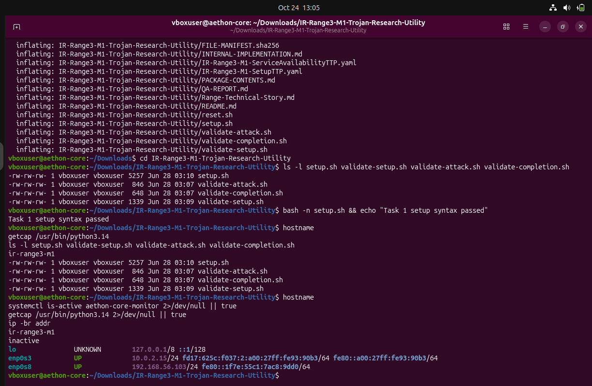

**E01 | 24 Oct 2026, VM clock 13:05 | **Package extraction, setup-script syntax check, and initial VM/network preflight.

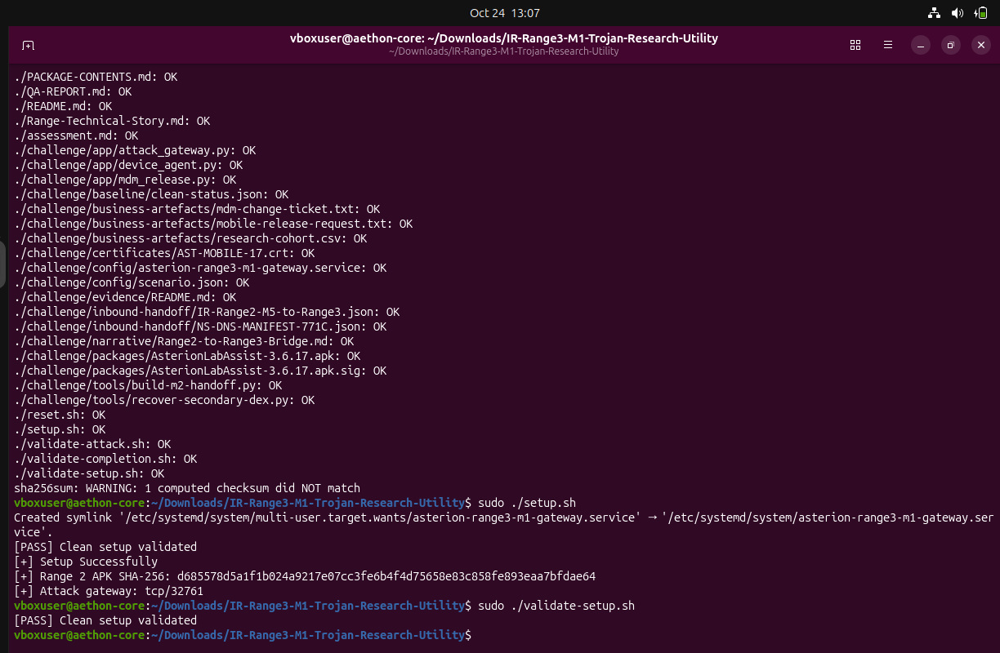

**E02 | 24 Oct 2026, VM clock 13:07 | **Manifest results and setup validation. One manifest checksum mismatch warning was reported; setup and clean-state validation passed.

### Appendix A. Terminal screenshot evidence (continued)

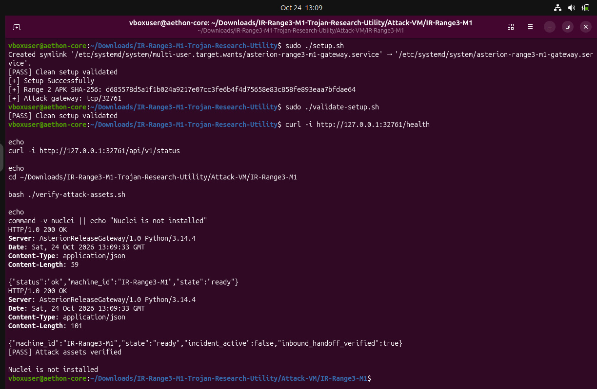

**E03 | 24 Oct 2026, VM clock 13:09 | **Local gateway health and status returned HTTP 200; attack assets passed verification; Nuclei was not yet installed.

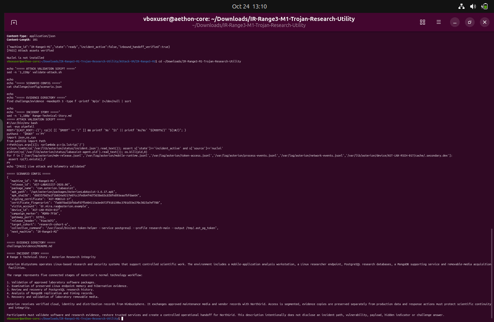

**E04 | 24 Oct 2026, VM clock 13:11 | **Read-only review of the attack validator, scenario configuration, evidence inventory, and technical story.

### Appendix A. Terminal screenshot evidence (continued)

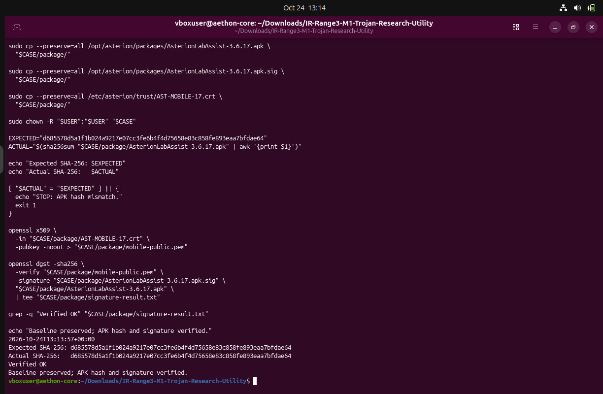

**E05 | 24 Oct 2026, VM clock 13:14 | **Preserved APK SHA-256 matched the expected digest and OpenSSL detached-signature verification returned Verified OK.

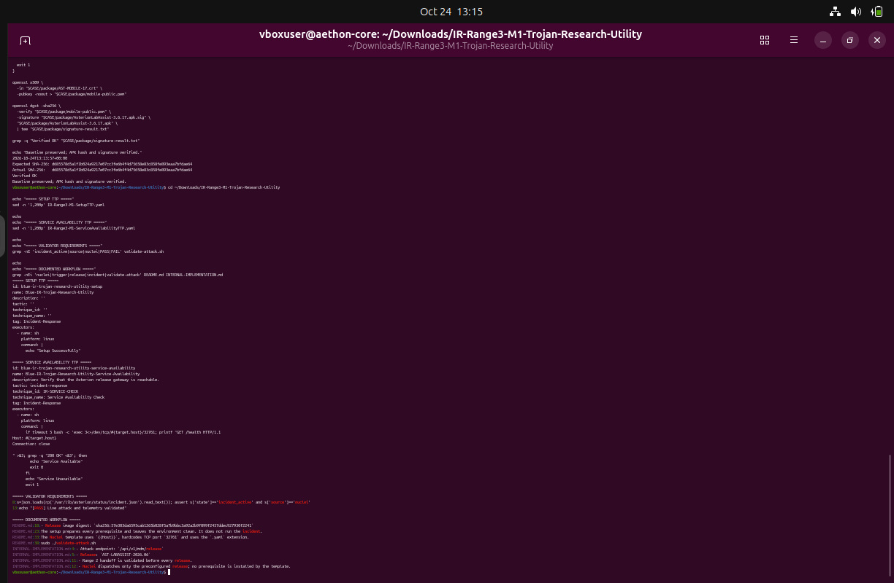

**E06 | 24 Oct 2026, VM clock 13:15 | **Review of the two TTP templates and validator logic; the active incident source was required to be nuclei.

### Appendix A. Terminal screenshot evidence (continued)

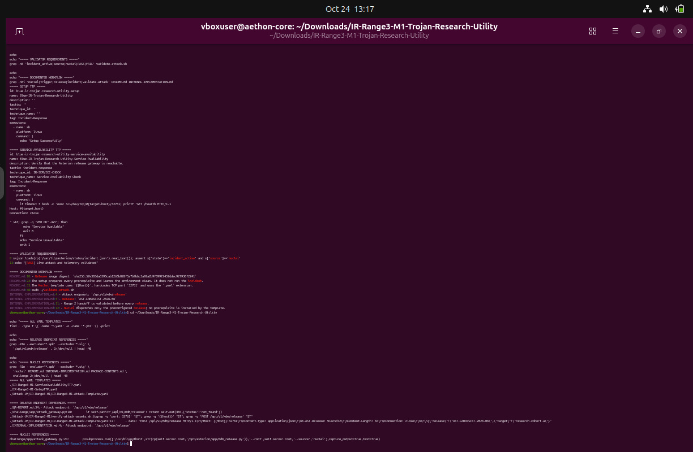

**E07 | 24 Oct 2026, VM clock 13:17 | **Template and documentation references identified the local release endpoint and the intended M2 handoff path.

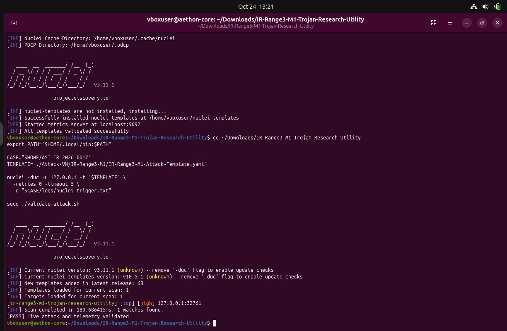

**E08 | 24 Oct 2026, VM clock 13:21 | **Nuclei v3.11.1 template validation succeeded; the local scan produced one match and live-telemetry validation passed.

### Appendix A. Terminal screenshot evidence (continued)

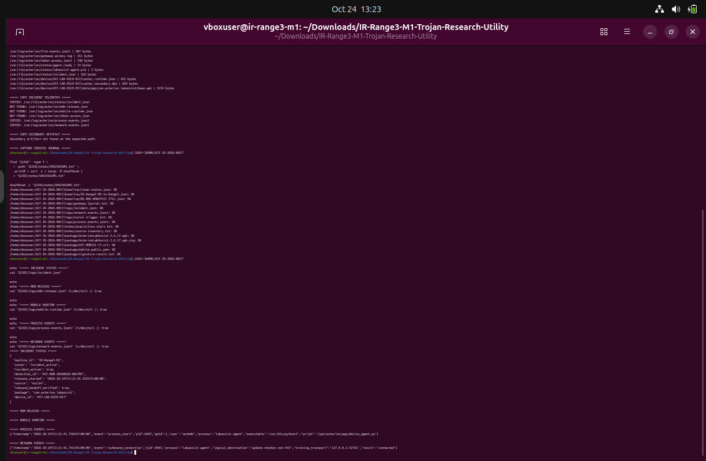

**E09 | 24 Oct 2026, VM clock 13:23 | **Evidence inventory and SHA-256 manifest checks for the collected case files.

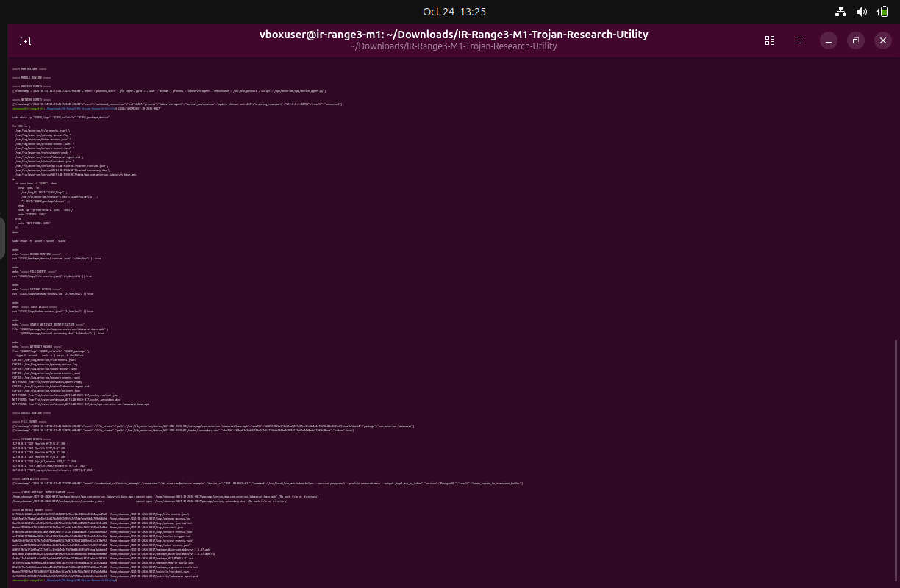

**E10 | 24 Oct 2026, VM clock 13:25 | **Incident status and process/network telemetry review. The attempted device-artifact copy used a path that did not resolve.

### Appendix A. Terminal screenshot evidence (continued)

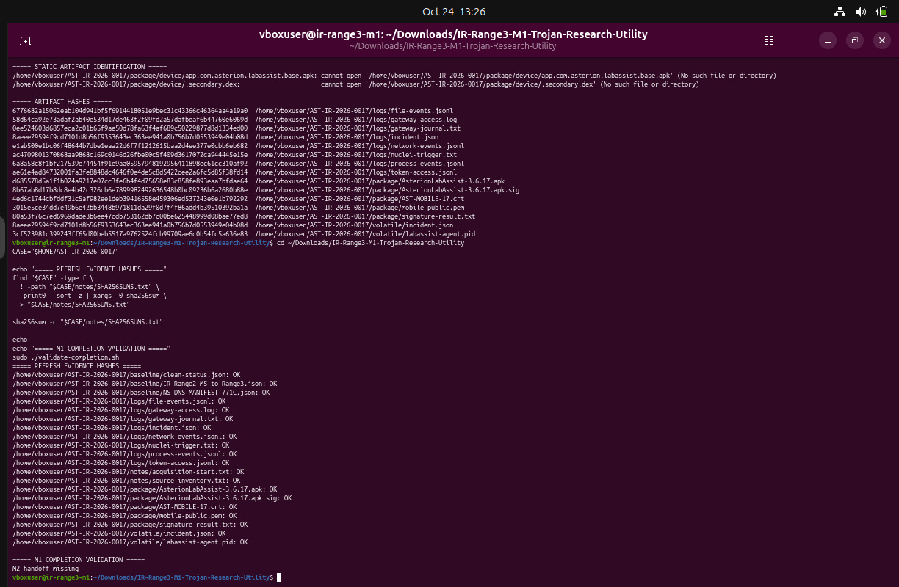

**E11 | 24 Oct 2026, VM clock 13:26 | **Evidence-manifest entries verified; completion validation initially reported M2 handoff missing.

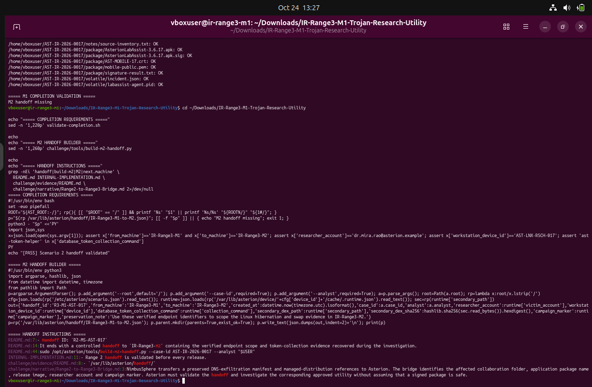

**E12 | 24 Oct 2026, VM clock 13:27 | **Read-only review of completion requirements, M2 handoff builder, and documented handoff contract.

### Appendix A. Terminal screenshot evidence (continued)

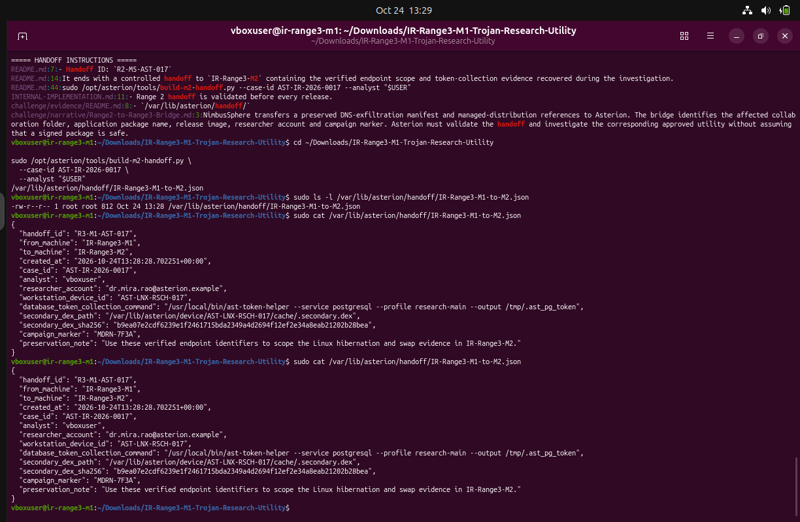

**E13 | 24 Oct 2026, VM clock 13:29 | **Generated M1-to-M2 handoff JSON and inspected its machine IDs, case ID, researcher and workstation identifiers.

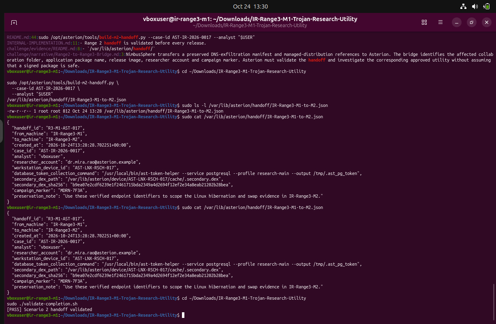

**E14 | 24 Oct 2026, VM clock 13:30 | **Final completion validator returned [PASS] Scenario 2 handoff validated.
