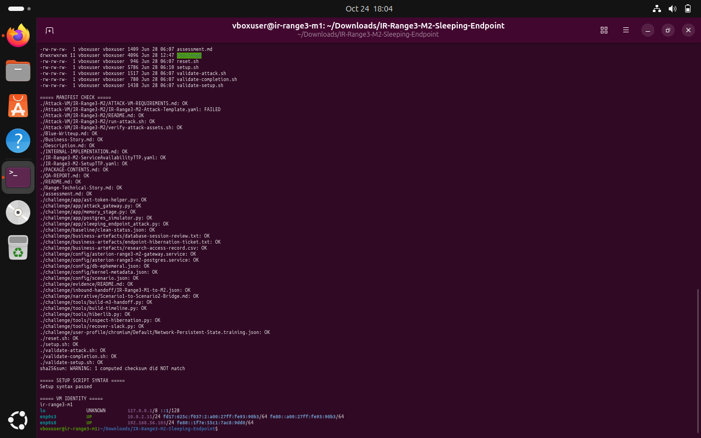
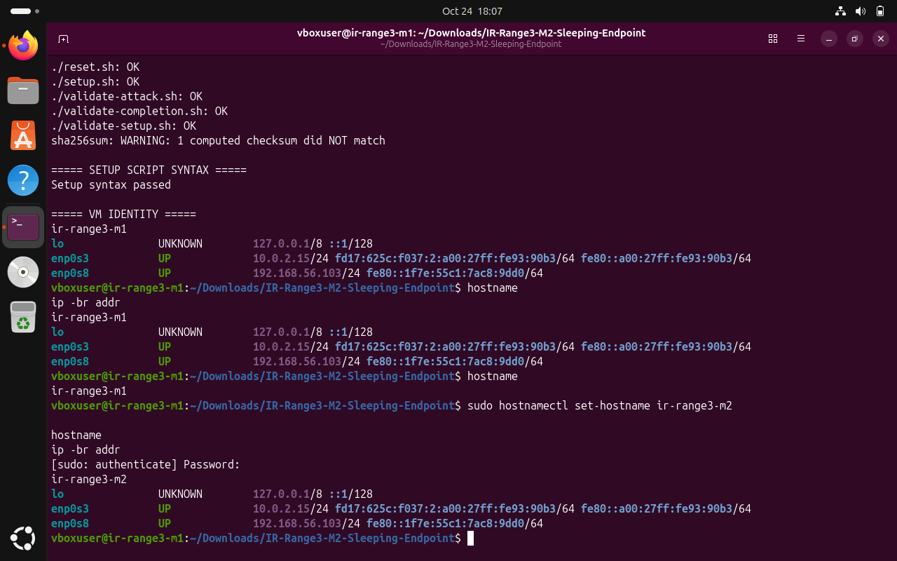
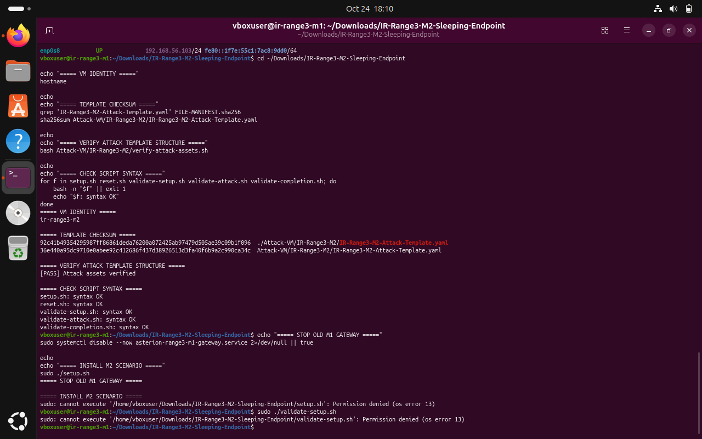
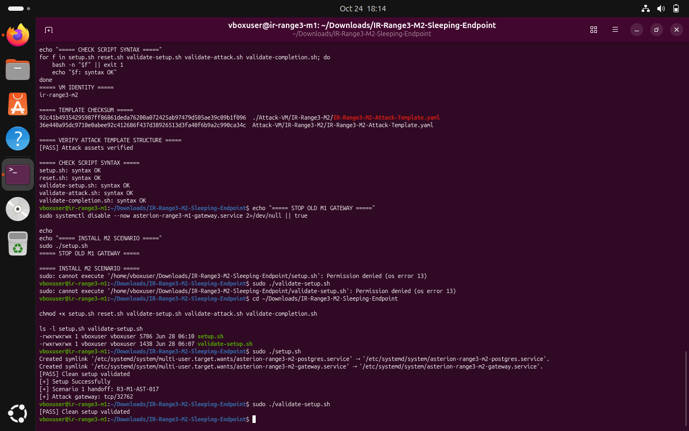
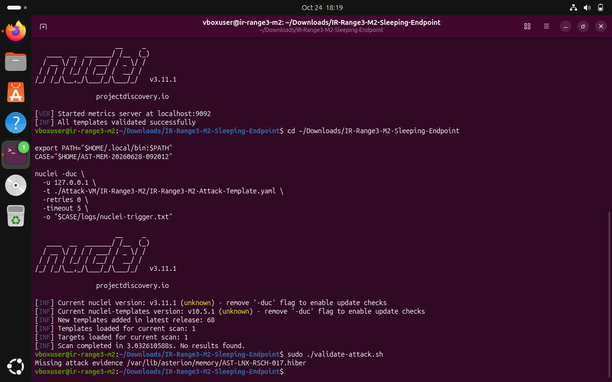
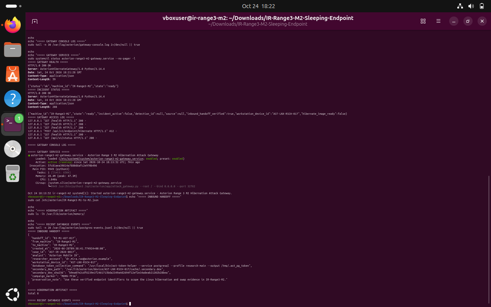
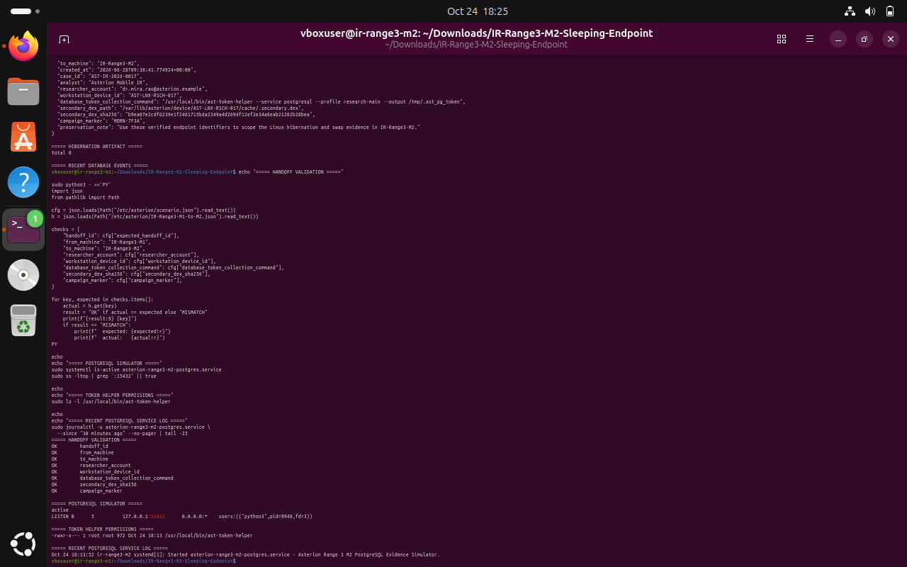
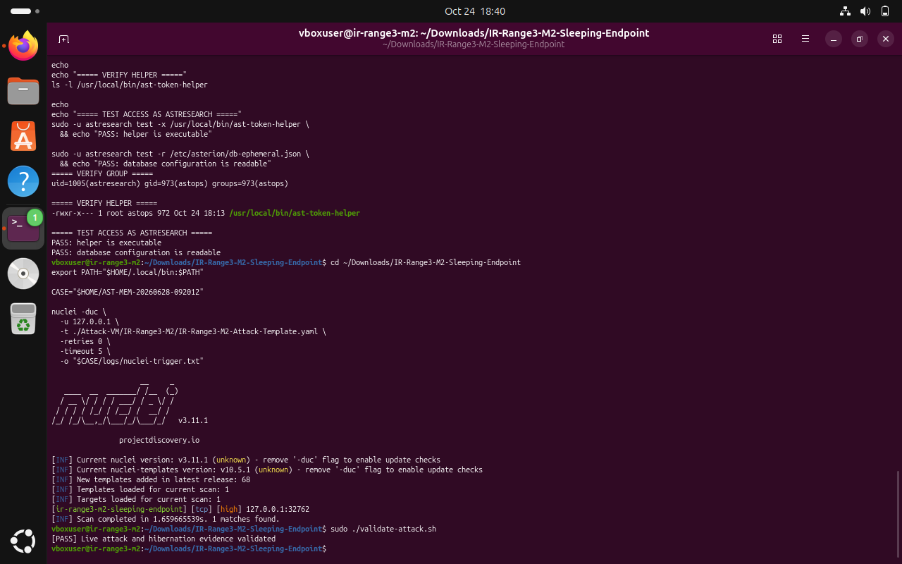
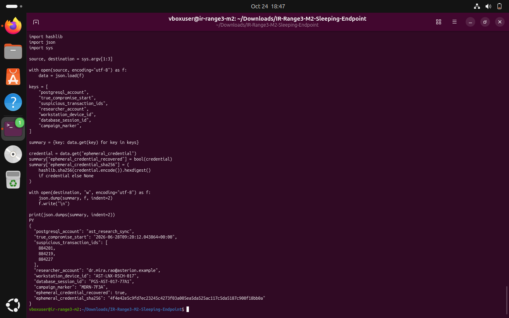
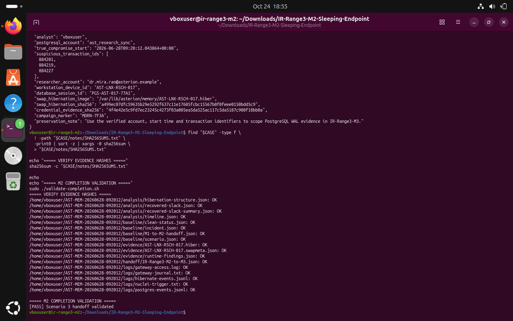

# IR-Range3-M2 — Sleeping Endpoint

> **Case ID:** `AST-MEM-20260628-092012`  
> **Handoff:** M2 → M3 handoff  
> **Scope:** Local lab gateway on 127.0.0.1:32762. Hibernation image and recovered slack were analysed using supplied tools; raw ephemeral credential is not included.

**Source note:** This Markdown write-up is derived from the completed Word report for the controlled Asterion Range 3 lab. Each terminal screenshot appears inline directly after the command block or investigation step it supports; image files are stored under `../evidence/M2/` so GitHub can render the relative links. Interpret findings within the simulated lab context.

---

## 1. Executive Summary

IR-Range3-M2, “Sleeping Endpoint,” continues the verified Scenario 1 handoff from IR-Range3-M1. The M2 exercise creates a controlled hibernation-evidence artifact, requires inspection of compressed-page allocation slack, and forwards the account, timestamp, transaction identifiers, and evidence hashes to IR-Range3-M3 for PostgreSQL WAL scoping.

> FINAL RESULT
> The supplied local Nuclei template matched once; validate-attack.sh passed; the recovered summary contained the expected PostgreSQL account, compromise time, and three transaction identifiers; the evidence SHA-256 manifest verified; and validate-completion.sh returned “[PASS] Scenario 3 handoff validated.”

### Outcome at a glance

| CHECKPOINT | RESULT | EVIDENCE |
| --- | --- | --- |
| M2 setup / clean state | PASS | E04 |
| Attack template asset structure | PASS; one manifest hash mismatch recorded | E01 |
| First trigger attempt | No match; prerequisite issue diagnosed | E05–E07 |
| Controlled trigger after permission correction | PASS; 1 match | E08 |
| Memory-fragment recovery | Completed; expected indicators visible in sanitized summary | E09 |
| Evidence SHA-256 verification | All listed saved artifacts reported OK | E10 |
| M2-to-M3 handoff / completion validator | PASS | E10 |

### Key recovered indicators

| INDICATOR | RECOVERED VALUE |
| --- | --- |
| PostgreSQL account | ast_research_sync |
| True compromise start (UTC) | 2026-06-28T09:20:12.043864+00:00 |
| Suspicious transaction IDs | 884201, 884219, 884227 |
| Researcher | dr.mira.rao@asterion.example |
| Workstation | AST-LNX-RSCH-017 |
| Database session | PGS-AST-017-77A1 |
| Campaign marker | MDRN-7F3A |

> CREDENTIAL HANDLING
> The scenario reported an ephemeral credential as recovered. The credential value is deliberately omitted from this report and was not used to authenticate. The generated handoff stores a credential-evidence SHA-256, not the raw credential.

## 2. Scope, Environment & Evidence Handling

Scope was limited to the local M2 virtual-machine challenge package and its loopback services. The supplied Nuclei template was run against 127.0.0.1; no external endpoint was scanned. The endpoint events and account/transaction records are simulated challenge telemetry, not evidence that a real external system was contacted.

| COMPONENT | OBSERVED / CONFIGURED VALUE |
| --- | --- |
| Scenario | IR-Range3-M2 — Sleeping Endpoint |
| Terminal hostname during M2 workflow | ir-range3-m2 |
| M2 attack gateway | TCP 32762; local target 127.0.0.1 |
| PostgreSQL evidence simulator | 127.0.0.1:15432 |
| Nuclei | v3.11.1; templates reported as validated |
| Inbound handoff ID | R3-M1-AST-017 |
| Case directory | ~/AST-MEM-20260628-092012 |
| Handoff output | /var/lib/asterion/handoff/IR-Range3-M2-to-M3.json |

### Evidence handling approach

- Preserved the clean status, installed scenario configuration, and inbound M1-to-M2 handoff before the investigation progressed.
- Copied hibernation image and metadata, runtime findings, service/access logs, and incident state into the case folder while retaining original timestamps/metadata where cp --preserve=all was used.
- Generated a hibernation-structure JSON, recovered-slack JSON, sanitized recovery summary, timeline JSON, and M2-to-M3 handoff JSON.
- Generated notes/SHA256SUMS.txt from the saved case folder and checked each listed file with sha256sum -c.
### Important execution boundary

> VM CLONING WAS DEFERRED BY OPERATOR INSTRUCTION
> The terminal initially showed ir-range3-m1. The hostname was changed to ir-range3-m2 and the M2 setup was then run on the current VM before cloning. The M2 setup changes Asterion runtime files and services, so the live VM should not be described as an untouched M1 baseline after this point. The M1 report and its saved case folder remain separate documentation artifacts. For future replays, create a full VM clone or snapshot before running a scenario that mutates shared runtime state.

### Integrity exception

> ONE MANIFEST HASH MISMATCH WAS RECORDED
> FILE-MANIFEST.sha256 reported a mismatch for Attack-VM/IR-Range3-M2/IR-Range3-M2-Attack-Template.yaml. The package-provided verify-attack-assets.sh nevertheless returned “[PASS] Attack assets verified,” and the template later validated and produced one controlled local match. The report preserves this exception; the manifest was not edited to conceal it.

## 3. Procedure & Commands

### Step 1 — Check package integrity and syntax

The archive was extracted and the manifest checked. All listed package files except the M2 attack-template YAML matched the manifest. The shell syntax checks and package-provided asset verifier were run without changing the manifest.

```bash
cd ~/Downloads/IR-Range3-M2-Sleeping-Endpoint
sha256sum -c FILE-MANIFEST.sha256
bash Attack-VM/IR-Range3-M2/verify-attack-assets.sh
for f in setup.sh reset.sh validate-setup.sh validate-attack.sh validate-completion.sh; do
  bash -n "$f" || exit 1
  echo "$f: syntax OK"
done
```



*Figure E01. One template-hash mismatch was retained as an integrity exception; the built-in asset verifier and syntax checks passed.*

### Step 2 — Set the M2 hostname and record the first permission failure

The hostname was changed to `ir-range3-m2`. The operator elected to continue on the current VM before making a clone; the live VM therefore should not be described as an untouched M1 baseline after M2 setup.

```bash
sudo hostnamectl set-hostname ir-range3-m2
hostname
ip -br addr
```



*Figure E02. The terminal confirmed the M2 hostname and network interfaces.*

The first direct script execution failed because the scripts did not have execute permission. This was a permissions issue, not a shell syntax error.

```bash
cd ~/Downloads/IR-Range3-M2-Sleeping-Endpoint
sudo ./setup.sh
sudo ./validate-setup.sh
```



*Figure E03. The initial setup/validation invocation failed until the execute bits were added.*

### Step 3 — Install and validate the clean M2 state

```bash
cd ~/Downloads/IR-Range3-M2-Sleeping-Endpoint
chmod +x setup.sh reset.sh validate-setup.sh validate-attack.sh validate-completion.sh
ls -l setup.sh validate-setup.sh
sudo ./setup.sh
sudo ./validate-setup.sh
```



*Figure E04. Setup created the gateway and PostgreSQL simulator, reported the inbound handoff ID `R3-M1-AST-017`, and returned `[PASS] Clean setup validated`.*

### Step 4 — Validate the template and record the first unsuccessful trigger

```bash
export PATH="$HOME/.local/bin:$PATH"
cd ~/Downloads/IR-Range3-M2-Sleeping-Endpoint
CASE="$HOME/AST-MEM-20260628-092012"
TEMPLATE="./Attack-VM/IR-Range3-M2/IR-Range3-M2-Attack-Template.yaml"
nuclei -duc -validate -t "$TEMPLATE"
nuclei -duc -u 127.0.0.1 -t "$TEMPLATE" -retries 0 -timeout 5 \
  -o "$CASE/logs/nuclei-trigger.txt"
sudo ./validate-attack.sh
```



*Figure E05. Nuclei loaded the template but produced no match; the validator reported that the hibernation artifact was absent, so the scenario was not yet considered successful.*

### Step 5 — Diagnose HTTP 412 and inspect prerequisites

First, the health/status routes and gateway logs were checked. The gateway was healthy, but the incident was inactive and `hibernate_image_ready` was false. The attempted hibernation endpoint returned HTTP 412.

```bash
curl -i --max-time 3 http://127.0.0.1:32762/health
curl -i --max-time 3 http://127.0.0.1:32762/api/v1/status
sudo tail -n 20 /var/log/asterion/gateway-access.log
sudo systemctl status asterion-range3-m2-gateway.service --no-pager -l
```



*Figure E06. Health/status were available; the request failed a scenario precondition rather than a network connection.*

The inbound handoff values were compared with the M2 scenario configuration. The PostgreSQL simulator was listening on `127.0.0.1:15432`. Inspection showed the token helper had restrictive mode `0750` but was owned by `root:root`, preventing the `astresearch` account (group `astops`) from executing it.

```bash
sudo cat /etc/asterion/IR-Range3-M1-to-M2.json
sudo systemctl is-active asterion-range3-m2-postgres.service
sudo ss -ltnp | grep ':15432' || true
id astresearch
sudo ls -l /usr/local/bin/ast-token-helper
sudo ls -l /etc/asterion/db-ephemeral.json
```



*Figure E07. The eight handoff/configuration comparisons passed; the helper’s group ownership was identified as the likely failed prerequisite.*

### Step 6 — Correct token-helper access and rerun the controlled trigger

The helper group was changed to `astops` while preserving mode `0750`. Effective access was tested as the scenario user before the supplied local template was retriggered.

```bash
sudo chgrp astops /usr/local/bin/ast-token-helper
sudo chmod 0750 /usr/local/bin/ast-token-helper
id astresearch
ls -l /usr/local/bin/ast-token-helper
sudo -u astresearch test -x /usr/local/bin/ast-token-helper \
  && echo "PASS: helper is executable"
sudo -u astresearch test -r /etc/asterion/db-ephemeral.json \
  && echo "PASS: database configuration is readable"

export PATH="$HOME/.local/bin:$PATH"
CASE="$HOME/AST-MEM-20260628-092012"
TEMPLATE="./Attack-VM/IR-Range3-M2/IR-Range3-M2-Attack-Template.yaml"
nuclei -duc -u 127.0.0.1 -t "$TEMPLATE" -retries 0 -timeout 5 \
  -o "$CASE/logs/nuclei-trigger.txt"
sudo ./validate-attack.sh
```



*Figure E08. After the permissions correction, the supplied template matched once and the live hibernation-evidence validator passed.*

## 4. Forensic Recovery & Findings

### Step 7 — Preserve incident artifacts

Evidence was copied to `~/AST-MEM-20260628-092012` with separate `baseline`, `evidence`, `logs`, `analysis`, `handoff`, and `notes` directories. The hibernation image/metadata, runtime findings, event logs, gateway logs, inbound handoff, scenario configuration, and incident status were preserved.

```bash
CASE="$HOME/AST-MEM-20260628-092012"
mkdir -p "$CASE"/{baseline,evidence,logs,analysis,handoff,notes}
sudo cp --preserve=all /var/lib/asterion/memory/AST-LNX-RSCH-017.hiber "$CASE/evidence/"
sudo cp --preserve=all /var/lib/asterion/memory/AST-LNX-RSCH-017.swapmeta.json "$CASE/evidence/"
sudo cp --preserve=all /var/lib/asterion/evidence/runtime-findings.json "$CASE/evidence/"
sudo cp --preserve=all /var/log/asterion/hibernate-events.jsonl "$CASE/logs/"
sudo cp --preserve=all /var/log/asterion/postgres-events.jsonl "$CASE/logs/"
sudo chown -R "$USER":"$USER" "$CASE"
```

### Step 8 — Inspect hibernation, recover slack, and build the timeline

```bash
cd ~/Downloads/IR-Range3-M2-Sleeping-Endpoint
CASE="$HOME/AST-MEM-20260628-092012"
python3 challenge/tools/inspect-hibernation.py \
  "$CASE/evidence/AST-LNX-RSCH-017.hiber" --json \
  > "$CASE/analysis/hibernation-structure.json"
python3 challenge/tools/recover-slack.py \
  "$CASE/evidence/AST-LNX-RSCH-017.hiber" \
  --output "$CASE/analysis/recovered-slack.json"
python3 challenge/tools/build-timeline.py "$CASE/logs" \
  --output "$CASE/analysis/timeline.json"
```

The raw recovered-slack JSON contains the simulated ephemeral credential and must remain private. The following script emits only the recovered indicators and a boolean plus SHA-256 for the credential; it does not print the credential value.

```bash
umask 077
CASE="$HOME/AST-MEM-20260628-092012"
chmod 600 "$CASE/analysis/recovered-slack.json"
python3 - "$CASE/analysis/recovered-slack.json" \
  "$CASE/analysis/recovered-slack-summary.json" <<'PY'
import hashlib, json, sys
source, destination = sys.argv[1:3]
with open(source, encoding="utf-8") as f:
    data = json.load(f)
keys = [
    "postgresql_account", "true_compromise_start", "suspicious_transaction_ids",
    "researcher_account", "workstation_device_id", "database_session_id", "campaign_marker",
]
summary = {key: data.get(key) for key in keys}
credential = data.get("ephemeral_credential")
summary["ephemeral_credential_recovered"] = bool(credential)
summary["ephemeral_credential_sha256"] = (
    hashlib.sha256(credential.encode()).hexdigest() if credential else None
)
with open(destination, "w", encoding="utf-8") as f:
    json.dump(summary, f, indent=2)
    f.write("\n")
print(json.dumps(summary, indent=2))
PY
```



*Figure E09. The summary confirms the PostgreSQL account, compromise timestamp, transaction IDs, researcher, workstation, database session, and campaign marker. The raw credential is not shown.*

### Verified recovered indicators

| INDICATOR | RECOVERED VALUE |
| --- | --- |
| PostgreSQL account | `ast_research_sync` |
| True compromise start (UTC) | `2026-06-28T09:20:12.043864+00:00` |
| Suspicious transaction IDs | `884201`, `884219`, `884227` |
| Researcher | `dr.mira.rao@asterion.example` |
| Workstation | `AST-LNX-RSCH-017` |
| Database session | `PGS-AST-017-77A1` |
| Campaign marker | `MDRN-7F3A` |

### Step 9 — Generate the M2-to-M3 handoff

```bash
CASE="$HOME/AST-MEM-20260628-092012"
sudo python3 challenge/tools/build-m3-handoff.py \
  --case-id AST-MEM-20260628-092012 --analyst "$USER"
sudo cp --preserve=all \
  /var/lib/asterion/handoff/IR-Range3-M2-to-M3.json "$CASE/handoff/"
sudo chown -R "$USER":"$USER" "$CASE"
cat "$CASE/handoff/IR-Range3-M2-to-M3.json"
```

The handoff identifies `IR-Range3-M2` → `IR-Range3-M3` and carries the account, compromise start, transaction IDs, workstation/session references, hibernation-image path and SHA-256, credential-evidence SHA-256, and a note directing M3 to scope PostgreSQL WAL evidence. The raw credential is not needed in the handoff.

### Step 10 — Hash the case folder and validate completion

```bash
CASE="$HOME/AST-MEM-20260628-092012"
find "$CASE" -type f \
  ! -path "$CASE/notes/SHA256SUMS.txt" -print0 \
  | sort -z | xargs -0 sha256sum > "$CASE/notes/SHA256SUMS.txt"
sha256sum -c "$CASE/notes/SHA256SUMS.txt"
sudo ./validate-completion.sh
```



*Figure E10. The saved artifacts reported `OK`; final output: `[PASS] Scenario 3 handoff validated`.*

## 5. Evidence Register & Final State

| CASE-PATH ARTIFACT | PURPOSE / RESULT |
| --- | --- |
| baseline/clean-status.json | Preserved clean-state status from before the scenario. |
| baseline/incident.json | Incident-state evidence copied after activation. |
| baseline/M1-to-M2-handoff.json | Original input handoff for continuity checks. |
| baseline/scenario.json | Scenario configuration used for field comparisons. |
| evidence/AST-LNX-RSCH-017.hiber | Primary hibernation artifact. |
| evidence/AST-LNX-RSCH-017.swapmeta.json | Hibernation metadata. |
| evidence/runtime-findings.json | Runtime evidence findings from the scenario. |
| logs/hibernate-events.jsonl | Hibernation activity log. |
| logs/postgres-events.jsonl | Database-simulator event log. |
| logs/gateway-access.log and gateway-journal.txt | Gateway requests and service journal. |
| logs/nuclei-trigger.txt | Supplied local template trigger output. |
| analysis/hibernation-structure.json | Parsed image structure result. |
| analysis/recovered-slack.json | Recovered indicators; contains the simulated credential—keep private. |
| analysis/recovered-slack-summary.json | Sanitized findings and credential hash only. |
| analysis/timeline.json | Correlated event timeline output. |
| handoff/IR-Range3-M2-to-M3.json | Validated outgoing handoff. |
| notes/SHA256SUMS.txt | Manifest used to verify the saved case files. |

### Final validation record

> COMPLETION VALIDATOR
> Terminal output: “[PASS] Scenario 3 handoff validated.” SHA-256 verification reported OK for every case file listed in the screenshot. This validates the M2 lab gate and outgoing handoff; it does not by itself confirm that M3 WAL analysis or remediation has been performed.

### Known limitations and open follow-up

- The M2 attack-template file had a package manifest checksum mismatch. The built-in asset verifier, Nuclei template validation, controlled match, and validators passed, but the mismatch remains an integrity exception worth retaining in the audit trail.
- The initial trigger returned no match and the attempted hibernation endpoint returned HTTP 412. The helper’s group access was corrected; after that correction the supplied template matched and the validator passed.
- The raw recovered credential is sensitive evidence and is intentionally excluded from this report. The recovery output and the validator-created /var/lib/asterion/evidence/recovered-slack-validation.json should also be treated as sensitive. Do not use the credential to authenticate; keep any raw output under strict case access controls.
- M3 should correlate the three transaction IDs and session PGS-AST-017-77A1 with PostgreSQL WAL evidence using the recovered true compromise start time.
- Containment, eradication, workstation rebuild/recovery, and database-WAL review are downstream operational activities. They are not asserted as completed by the M2 completion validator.
## 6. Learning Points

| 1 | Validate the handoff before scoping.<br>The M1-to-M2 handoff anchors the researcher, endpoint, secondary artifact, token-helper command, and campaign marker to the same investigation chain. |
| --- | --- |

| 2 | A healthy service is not the same as a ready scenario.<br>The gateway returned HTTP 200 for health/status while the incident trigger returned HTTP 412 and the hibernation image was not ready. Inspect preconditions and service logs instead of repeatedly triggering. |
| --- | --- |

| 3 | Least-privilege permissions can block a controlled workflow.<br>The helper’s restrictive 0750 mode was appropriate, but its group ownership prevented the intended scenario account from executing it. Correct group access and test effective access as the service user. |
| --- | --- |

| 4 | Compressed-memory slack can retain evidence after a process exits.<br>The recovered hibernation slack exposed the authoritative compromise timestamp, PostgreSQL account/session, and transaction IDs that were necessary to scope the next stage. |
| --- | --- |

| 5 | Hash manifests support integrity and chain of custody.<br>Hashing the saved case files and checking the manifest makes later changes detectable. Record package hash exceptions explicitly; do not edit a manifest simply to make verification green. |
| --- | --- |

### Conclusion

The M2 lab gate was completed. The initial trigger issue was diagnosed, the controlled scenario was activated, the hibernation evidence and indicators were recovered, the case artifacts were hashed, and the M2-to-M3 handoff passed validation. The next stage is PostgreSQL WAL evidence scoping in IR-Range3-M3.
