# IR-Range3-M3 — Rewritten Experiment History

> **Case ID:** `AST-IR-2026-0031`  
> **Handoff:** M3 → M4 handoff  
> **Scope:** Local PostgreSQL lab gateway on 127.0.0.1:32763. Primary/continuity comparison, WAL evidence, timeline and handoff are documented; raw credential material is excluded.

**Source note:** This Markdown write-up is derived from the completed Word report for the corresponding controlled Asterion Range 3 lab. The evidence images are the terminal screenshots embedded in that report. Interpret findings within the simulated lab context.

---

## 1. Executive Summary

Scenario 3 simulated an application-history integrity incident in the M3 PostgreSQL environment. The supplied local Nuclei template matched the M3 gateway, the lab validator confirmed the PostgreSQL/WAL/logical-decoding scenario, and the investigator compared the primary database with a clean continuity cluster. Two experiment metrics differed between the current primary and clean reference. The evidence package and M3-to-M4 handoff were then saved and the completion validator passed.

| CHECKPOINT | OBSERVED RESULT | STATUS |
| --- | --- | --- |
| Package manifest / assets | Manifest entries verified; attack assets validated. | PASS |
| Clean baseline | Primary :55431 and clean continuity :55432 prepared; clean setup validator passed. | PASS |
| Local scenario | Nuclei reported one match at 127.0.0.1:32763. | PASS |
| Attack evidence | “Real PostgreSQL attack, WAL and logical decoding validated.” | PASS |
| Database comparison | Differences identified for EXP-AX17 and EXP-CR42. | COMPLETE |
| M3-to-M4 handoff | Generated to /var/lib/asterion/handoff/IR-Range3-M3-to-M4.json. | PASS |
| Evidence integrity | Saved case manifest reported OK for listed files. | PASS |
| Final validator | “Scenario 4 handoff validated.” | PASS |

### Conclusion at a glance

- The lab incident was associated with an active application-history conflict and WAL evidence readiness.
- The primary cluster showed EXP-AX17 viability_score = 68.4 versus 91.7 in the clean cluster, and EXP-CR42 response_index = 0.41 versus 0.83 in the clean cluster.
- The evidence set included database incident/access logs, PostgreSQL cluster logs, backup-manifest and control-data information, WAL files and a WAL manifest, a timeline, verified findings, and the M3-to-M4 handoff.
- The raw simulated ephemeral credential was not included in this report; only the fact of its evidence recovery is recorded where relevant.
## 2. Case Profile and Method

| ITEM | RECORDED VALUE |
| --- | --- |
| Case ID | AST-IR-2026-0031 |
| Detection ID | AST-DB-20260628-884227 |
| Scenario system ID | IR-Range3-M3 |
| Database session | PGS-AST-017-77A1 |
| Researcher identity in scenario | dr.mira.rao@asterion.example |
| Workstation ID | AST-LNX-RSCH-017 |
| Campaign marker | MDRN-7F3A |
| Primary PostgreSQL endpoint | 127.0.0.1:55431 |
| Clean continuity endpoint | 127.0.0.1:55432 |
| M3 gateway | 127.0.0.1:32763 |
| PostgreSQL version shown | 18.6 (Ubuntu 18.6-0ubuntu0.26.04.1) |

### Evidence method

- Package integrity and attack-asset checks before scenario execution.
- Clean baseline validation for the primary and continuity PostgreSQL clusters.
- Controlled local trigger with the package-provided Nuclei template; no external target was used.
- Preservation of supplied incident status, event logs, PostgreSQL logs, backup verification data, WAL artifacts, and manifests.
- Primary-versus-clean comparison, timestamped event timeline generation, verified-findings collection, and handoff generation.
- SHA-256 manifest generation and re-verification for the saved case folder.
**Environment identity note: **The terminal prompt continued to show hostname ir-range3-m2 during the M3 work, while the gateway response identified machine_id IR-Range3-M3. This discrepancy is preserved as an environment-labeling note; no claim is made that the hostname was corrected.

## 3. Principal Forensic Findings

### 3.1 Primary versus clean continuity values

| EXPERIMENT ID | METRIC | CLEAN CLUSTER | PRIMARY CLUSTER | ASSESSMENT |
| --- | --- | --- | --- | --- |
| EXP-AX17 | viability_score | 91.7 | 68.4 | Difference observed |
| EXP-CR42 | response_index | 0.83 | 0.41 | Difference observed |

The supplied cluster comparison marked the record integrity status as “verified” in both copies even though the values differed. That field is reported as recorded data, not treated as proof that the changed values are authentic.

### 3.2 Transaction and record references

| BUSINESS TRANSACTION REF | POSTGRESQL NATIVE XID | COMMIT TIMESTAMP (UTC) |
| --- | --- | --- |
| 884201 | 773 | 2026-10-25 00:10:14.532200+00:00 |
| 884219 | 774 | 2026-10-25 00:10:14.564766+00:00 |
| 884227 | 775 | 2026-10-25 00:10:14.598875+00:00 |

The recovered findings/handoff identify stolen_record_ids EXP-AX17, EXP-CR42, and EXP-NV08, and modified_record_ids EXP-AX17 and EXP-CR42. The database session was PGS-AST-017-77A1; the associated scenario MongoDB session was MONGO-AST-77A1-884227.

### 3.3 Scenario timing and audit claim

| FIELD | VALUE |
| --- | --- |
| Attack started | 2026-10-25T00:10:14.435993+00:00 |
| Attack completed | 2026-10-25T00:10:16.298254+00:00 |
| Recorded exfiltration window | 2026-10-25 00:10:14.594315+00:00 to 00:10:14.597024+00:00 |
| Application audit claim | routine_sync_completed at 2026-06-28 09:19:30+00:00; status normal; result_changes 0; protected_records_queried false |

The routine-sync entry is an application audit claim in the evidence. Its timestamp and claimed no-change behavior differ from the October 2026 scenario events; the report does not infer intent from that discrepancy alone.

## 4. Package Integrity and Preflight

The M3 package was unpacked and checked before installation. The SHA-256 manifest output showed the listed challenge assets as OK; the setup script passed bash syntax validation, and the supplied asset verifier reported success.

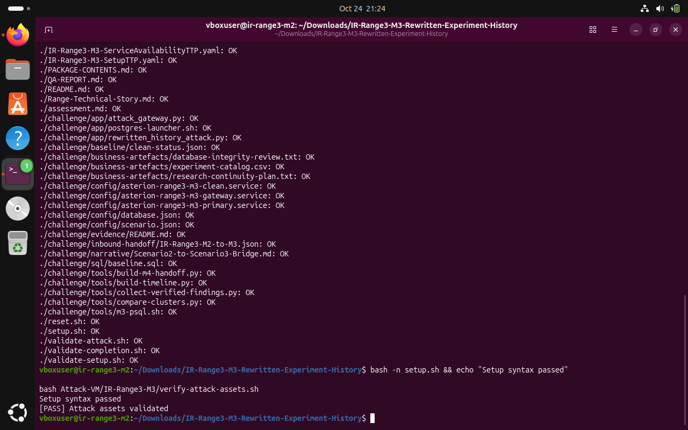

*E01 • Package integrity and preflight checks: manifest entries, setup syntax, and attack-asset verification.*

**Evidence note: **Establishes the initial package preflight checks and provides a traceable starting point for the runbook.

## 5. Baseline SQL Access Troubleshooting

The first setup attempt failed when psql tried to read challenge/sql/baseline.sql. A direct permission test for the PostgreSQL account had failed until access was granted to the actual service identity, astpg, with narrow directory traversal and file-read ACLs.

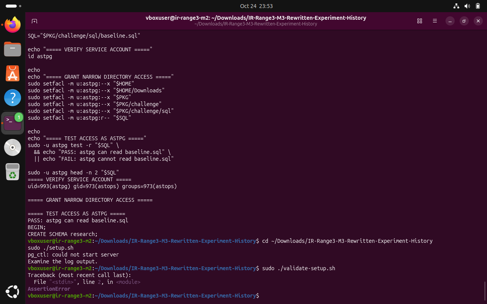

*E02 • Correct service-account access test passed for astpg; the subsequent setup attempt still failed while starting the clean PostgreSQL cluster.*

**Evidence note: **The remediation targeted only the account and path needed to read the baseline SQL; it did not make the script world-readable.

## 6. Clean Cluster Startup Permission Error

After the SQL access issue was addressed, PostgreSQL still refused to start the clean continuity cluster and reported invalid permissions on /var/lib/asterion/postgresql/clean. The log specifically described the accepted directory modes as 0700 or 0750.

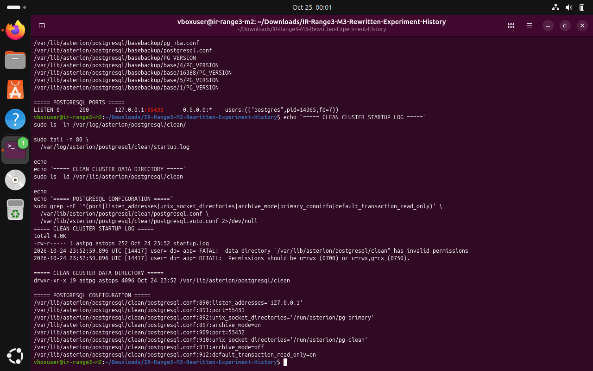

*E03 • Clean-cluster startup diagnosis: PostgreSQL reported invalid permissions on the clean data directory.*

**Evidence note: **Shows the separate data-directory permission issue. This was not the same error as the earlier baseline.sql access denial.

## 7. Local Installer Remediation and Baseline Pass

A manual chmod followed by another setup attempt still failed. The local copy of setup.sh was then backed up as setup.sh.before-clean-permission-fix and patched to enforce chmod 0700 /var/lib/asterion/postgresql/clean after chown and immediately before pg_ctl. The exact reason the earlier manual change did not suffice was not isolated further.

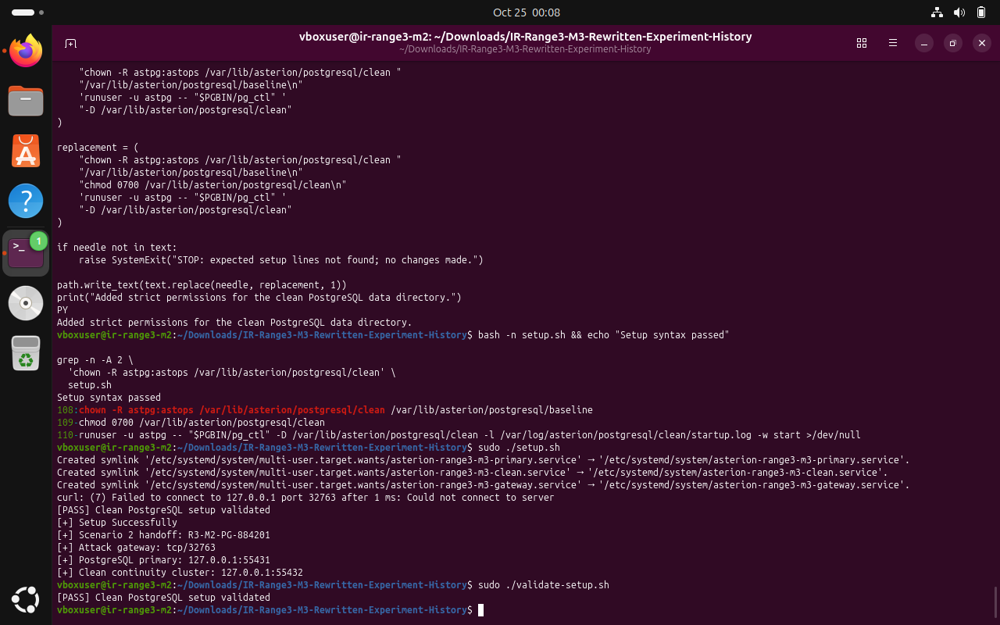

*E04 • Successful M3 setup after a local installer fix; the clean PostgreSQL setup validator passed.*

**Evidence note: **The modified installer then completed and sudo ./validate-setup.sh returned [PASS] Clean PostgreSQL setup validated. This is a lab-specific installer workaround and should be disclosed when reproducing the procedure.

## 8. Gateway Readiness and Template Validation

After clean-baseline validation, the gateway responded HTTP 200 on /health and /api/v1/status. Its pre-trigger status showed the primary and clean continuity clusters ready, inbound handoff verified, WAL evidence not yet ready, and scenario 4 handoff not yet ready. Nuclei reported all templates validated successfully.

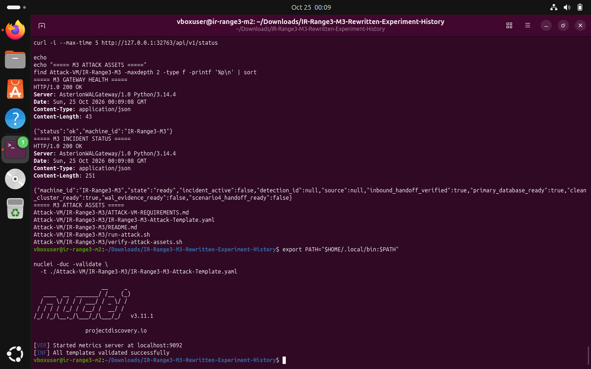

*E05 • M3 gateway health, incident readiness, and successful validation of the supplied Nuclei template.*

**Evidence note: **Confirms the pre-trigger state and validation of the supplied M3 template against the local challenge environment.

## 9. Controlled M3 Trigger and Attack Validation

The supplied M3 Nuclei template was executed against 127.0.0.1. Nuclei reported one match at 127.0.0.1:32763, then sudo ./validate-attack.sh returned [PASS] Real PostgreSQL attack, WAL and logical decoding validated.

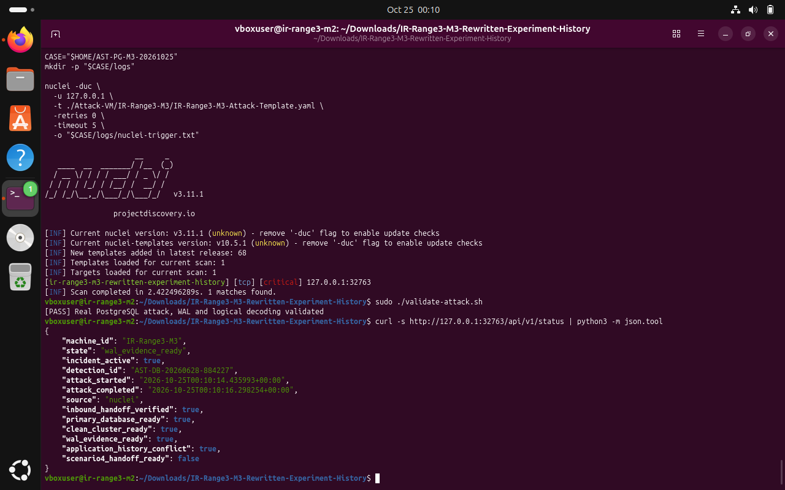

*E06 • Controlled local trigger matched once; the attack validator passed and status reported WAL evidence ready and an application-history conflict.*

**Evidence note: **The subsequent status showed incident_active=true, detection_id AST-DB-20260628-884227, application_history_conflict=true, wal_evidence_ready=true, and scenario4_handoff_ready=false before handoff creation.

## 10. Backup Verification and Primary/Clean Comparison

The investigator preserved the inbound M2 handoff, incident status, Asterion and PostgreSQL logs, WAL files and manifest, and backup-verification information under ~/AST-IR-2026-0031. The initial bare pg_verifybackup command was not found in PATH; invoking it using $(pg_config --bindir)/pg_verifybackup completed the verification successfully.

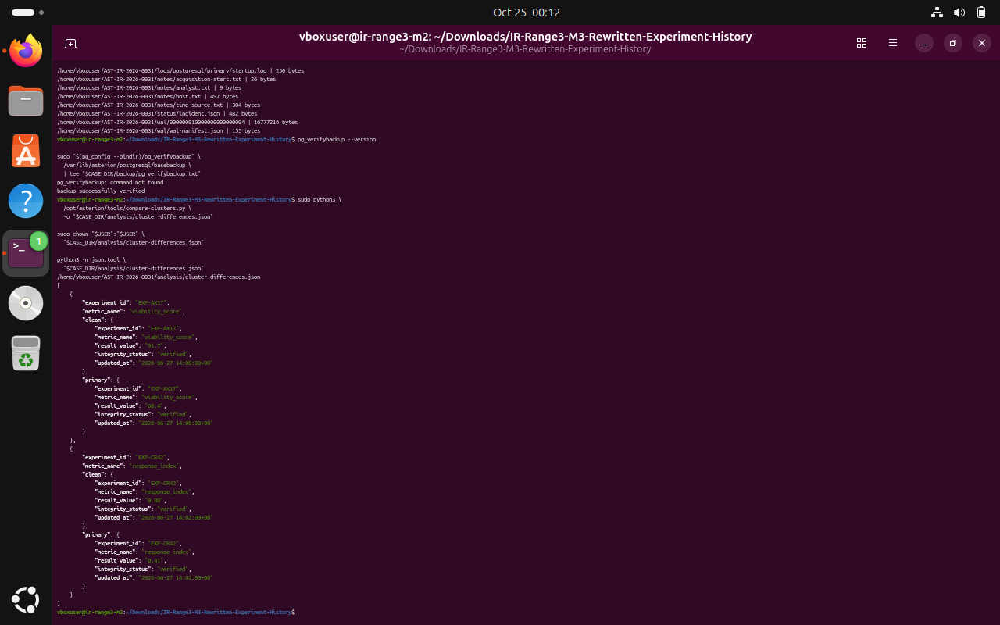

*E07 • Backup verification command and primary-versus-clean cluster comparison showing the two differing experiment values.*

**Evidence note: **The verification result was recorded in backup/pg_verifybackup.txt; the screenshot captures the acquisition work and checks. Raw credential values were not copied into the report.

## 11. Preserved Incident, WAL, and Backup Inventory

The preceding evidence capture shows the compare-clusters output in analysis/cluster-differences.json, including EXP-AX17 viability_score and EXP-CR42 response_index differences. This following acquisition screen documents the incident status and the collected evidence inventory, including the original/manipulated record-set hashes and WAL manifest.

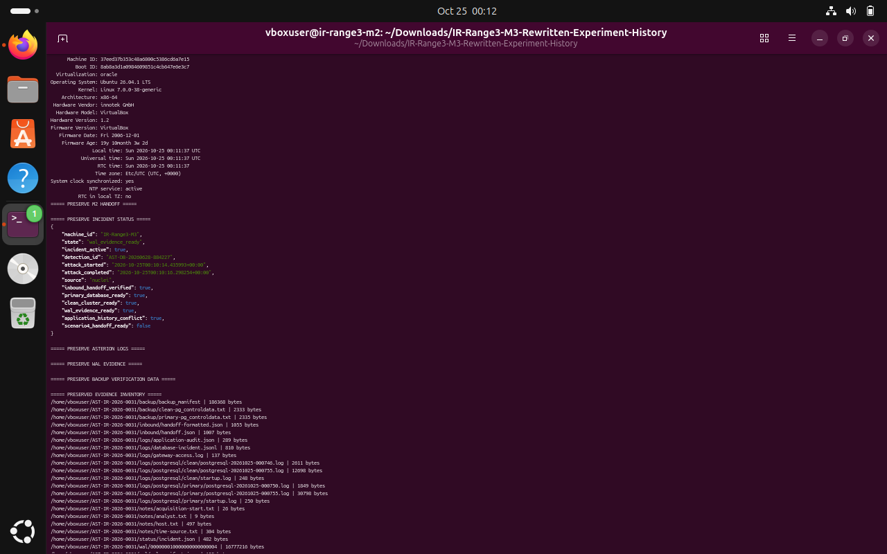

*E08 • Preserved incident status and inventory of the acquired inbound, backup, log, WAL, and manifest evidence.*

**Evidence note: **The clean continuity cluster is used as a reference. Differences are described as observations; the comparison alone does not establish who changed the values or why.

## 12. Timeline and Verified-Findings Workflow

The investigator generated analysis/timeline.json from the preserved logs. The preview correlates the database session start with committed business transaction references 884201, 884219, and 884227, and their PostgreSQL native XIDs 773, 774, and 775.

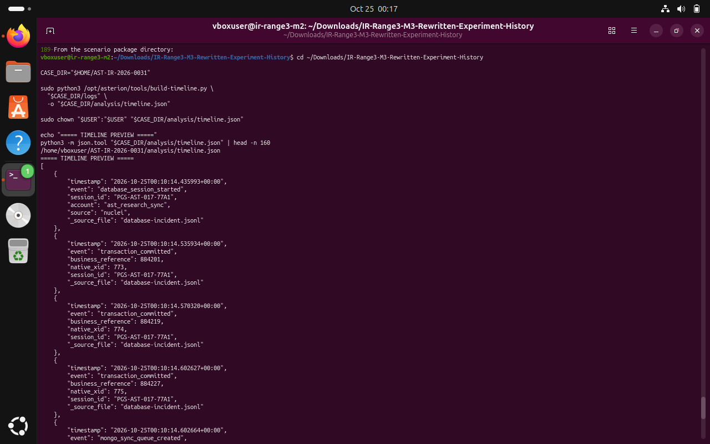

*E09 • Generated forensic timeline preview showing the PostgreSQL session, three committed transaction references, native XIDs, and timestamps.*

**Evidence note: **The final evidence manifest lists analysis/timeline.json and analysis/verified-findings.json. The timeline is a correlation aid; it should be read with the WAL manifest and database comparison, not as a stand-alone attribution of intent.

## 13. Verified Findings and Completion Validation

The verified-findings output recorded native PostgreSQL XIDs 773, 774, and 775; business transaction references 884201, 884219, and 884227; modified/stolen record IDs; database and scenario session identifiers; exfiltration time window; WAL manifest hash; researcher account; workstation ID; and campaign marker. The final completion validator printed [PASS] Scenario 4 handoff validated.

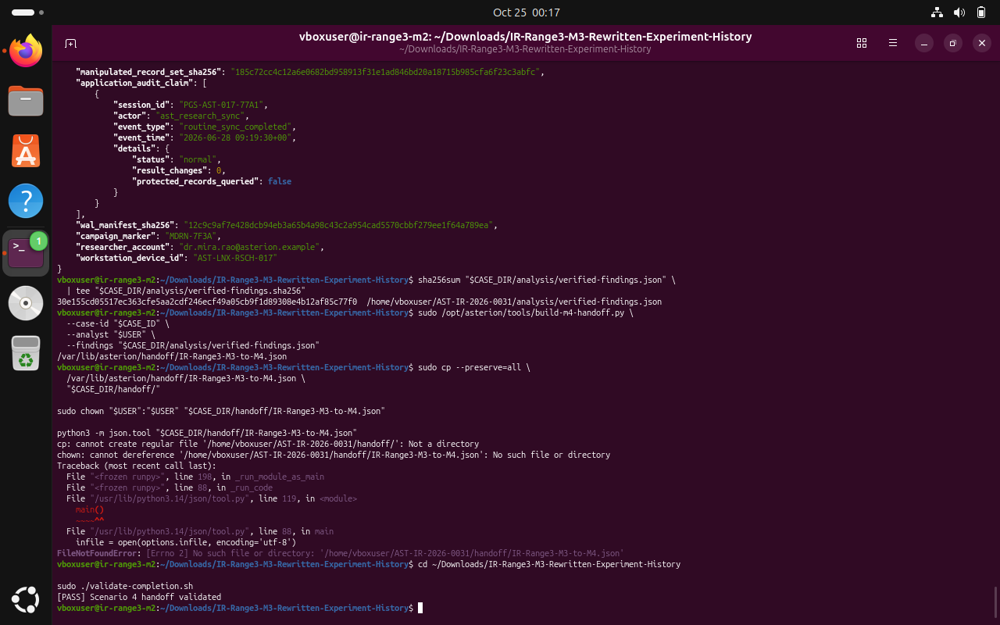

*E10 • Verified findings and M3-to-M4 handoff generation; the completion validator reports Scenario 4 handoff validated.*

**Evidence note: **The first attempt to copy the handoff into a local handoff subdirectory failed because that directory did not exist. The generated handoff remained at the system handoff path and was subsequently saved to the local analysis directory.

## 14. M3-to-M4 Handoff Artifact

The generated handoff/findings JSON identifies R3-M3-MONGO-77A1, from IR-Range3-M3 to IR-Range3-M4, with case ID AST-IR-2026-0031. It carries the relevant record IDs, native XIDs, transaction references, database and MongoDB session IDs, exfiltration window, WAL manifest SHA-256, campaign marker, and a preservation note for M4.

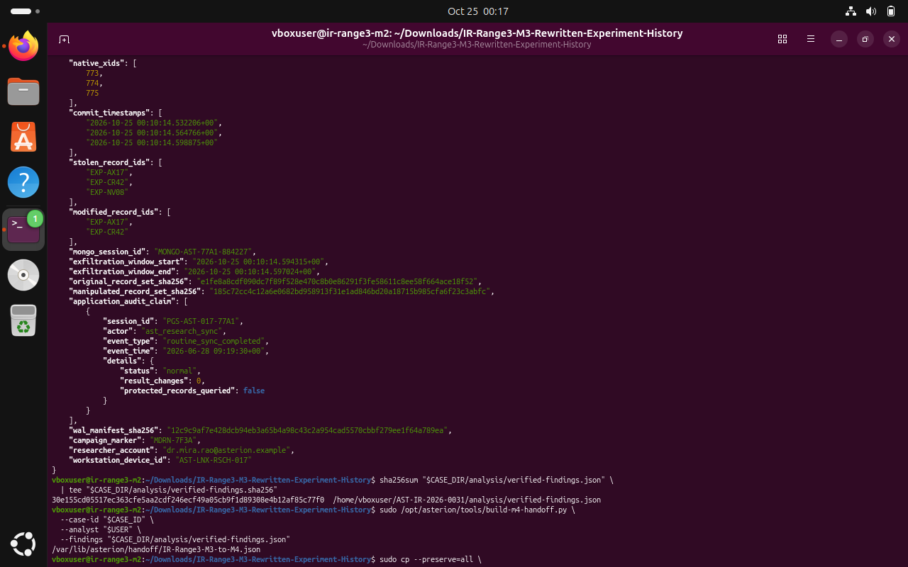

*E11 • Generated M3-to-M4 handoff/findings JSON with record identifiers, transaction references, session identifiers, exfiltration window, and WAL manifest hash.*

**Evidence note: **The handoff points M4 investigators toward the MongoDB session identifier and exact queue window needed to scope subsequent oplog timing evidence. The report intentionally excludes any raw credential material.

## 15. Saved Evidence SHA-256 Verification

After the M3-to-M4 handoff was copied into analysis/IR-Range3-M3-to-M4.json, a new SHA-256 manifest was generated for the case folder. The final verification screenshot shows the listed analysis, backup, inbound, log, notes, status, and WAL files each returning OK.

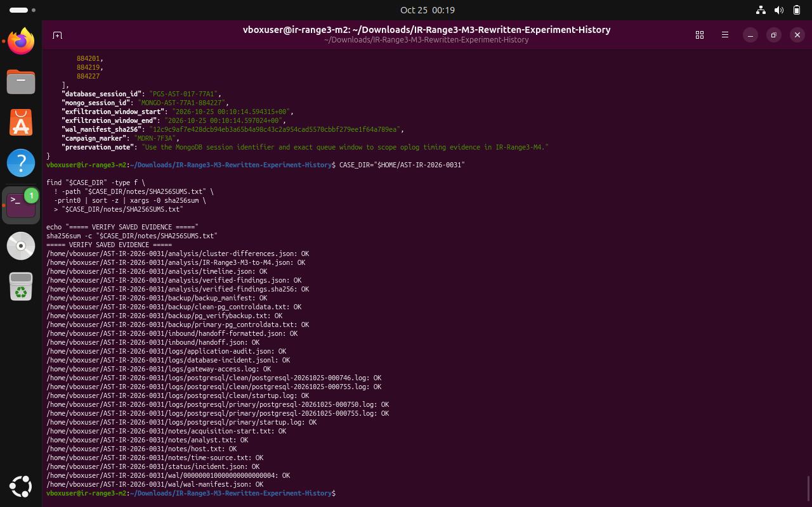

*E12 • Final saved-evidence SHA-256 manifest verification: listed evidence files returned OK.*

**Evidence note: **The screenshot demonstrates verification against the generated manifest. It does not prove that evidence existed before acquisition; acquisition notes and the earlier baseline/manifest are the context for chain-of-custody review.

## 16. Conclusion, Caveats, and Lessons Learned

### Outcome

M3 is complete according to the package validator. The controlled trigger ran, the attack validator confirmed the PostgreSQL/WAL/logical-decoding evidence, differences between primary and clean continuity records were recorded, verified findings were collected, the M3-to-M4 handoff was generated, and the final evidence manifest passed SHA-256 checks.

### Important caveats retained in the record

- The local M3 installer needed an ACL adjustment for astpg to read baseline.sql and a local setup.sh patch to enforce mode 0700 on the clean PostgreSQL data directory before starting it; the earlier manual chmod attempt still failed and the underlying reason was not isolated further.
- The setup/validator sequence produced a transient gateway readiness check failure during initial service startup; the final clean setup validator nevertheless passed.
- The terminal hostname remained ir-range3-m2 while the M3 gateway identified itself as IR-Range3-M3. That environment-label discrepancy was not silently corrected.
- An initial pg_verifybackup invocation by name failed because the command was not found in PATH; invoking the binary through pg_config --bindir succeeded.
- The first local handoff-copy operation failed because the destination handoff directory was absent. The system-generated handoff was then copied to the case analysis directory and validated. The trigger screenshot initially uses ~/AST-PG-M3-20261025 as its CASE path, while the final consolidated evidence manifest is under ~/AST-IR-2026-0031 and lists logs/nuclei-trigger.txt; retain this path discrepancy and any transfer details in the chain-of-custody record.
- The application audit routine-sync claim is presented as a recorded claim and is not independently treated as proof of a legitimate change-free sync.
### Five learning points

- Compare a primary database with an independently preserved continuity copy; “integrity_status: verified” is not enough when record values disagree.
- Preserve the base backup, control-data, WAL, manifests, and logs before attempting recovery or remediation.
- Use transaction references, native PostgreSQL XIDs, timestamps, database session IDs, and application audit claims together rather than relying on a single log source.
- Run the tool in its intended service-account context and inspect access control carefully; directory traversal and file-read permissions are distinct requirements.
- A successful handoff and a SHA-256 manifest improve continuity, but they supplement—not replace—acquisition notes, baseline preservation, and explicit caveats about modified setup scripts.
### Completion record

| CHECK | RESULT |
| --- | --- |
| Attack validator | PASS — Real PostgreSQL attack, WAL and logical decoding validated |
| Handoff generated | R3-M3-MONGO-77A1 |
| Handoff destination | /var/lib/asterion/handoff/IR-Range3-M3-to-M4.json |
| Local handoff copy | ~/AST-IR-2026-0031/analysis/IR-Range3-M3-to-M4.json |
| Completion validator | PASS — Scenario 4 handoff validated |
| Saved evidence manifest | All listed files returned OK |

## Appendix A. Reproduction Runbook — Package and Baseline

The commands below summarize the important actions performed in the lab. Paths are specific to the recorded Ubuntu VM. The local setup.sh patch and ACLs should be recorded as environmental remediations if the scenario is reproduced elsewhere.

### A1. Package checks

```bash
cd ~/Downloads/IR-Range3-M3-Rewritten-Experiment-History
sha256sum -c FILE-MANIFEST.sha256
bash -n setup.sh
bash Attack-VM/IR-Range3-M3/verify-attack-assets.sh
```

### A2. Permit astpg to read the baseline SQL

```bash
PKG="$HOME/Downloads/IR-Range3-M3-Rewritten-Experiment-History"
SQL="$PKG/challenge/sql/baseline.sql"
sudo setfacl -m u:astpg:--x "$HOME"
sudo setfacl -m u:astpg:--x "$HOME/Downloads"
sudo setfacl -m u:astpg:--x "$PKG"
sudo setfacl -m u:astpg:--x "$PKG/challenge"
sudo setfacl -m u:astpg:--x "$PKG/challenge/sql"
sudo setfacl -m u:astpg:r-- "$SQL"
sudo -u astpg test -r "$SQL"
```

### A3. Ensure strict clean-cluster mode in the installer

The local fix inserted the chmod line after the existing chown operation and before pg_ctl starts the clean cluster. The original installer was preserved as setup.sh.before-clean-permission-fix.

```bash
chown -R astpg:astops /var/lib/asterion/postgresql/clean /var/lib/asterion/postgresql/baseline
chmod 0700 /var/lib/asterion/postgresql/clean
runuser -u astpg -- "$PGBIN/pg_ctl" -D /var/lib/asterion/postgresql/clean -l /var/log/asterion/postgresql/clean/startup.log -w start >/dev/null
```

### A4. Setup / baseline checks

```bash
sudo ./setup.sh
sudo ./validate-setup.sh
curl -i --max-time 5 http://127.0.0.1:32763/health
curl -s http://127.0.0.1:32763/api/v1/status | python3 -m json.tool
```

## Appendix B. Reproduction Runbook — Trigger, Analysis, and Handoff

### B1. Controlled local trigger and validator

```bash
export PATH="$HOME/.local/bin:$PATH"
CASE_ID="AST-IR-2026-0031"
CASE_DIR="$HOME/AST-IR-2026-0031"
mkdir -p "$CASE_DIR/logs"
nuclei -duc -u 127.0.0.1 \
  -t ./Attack-VM/IR-Range3-M3/IR-Range3-M3-Attack-Template.yaml \
  -retries 0 -timeout 5 -o "$CASE_DIR/logs/nuclei-trigger.txt"
sudo ./validate-attack.sh
curl -s http://127.0.0.1:32763/api/v1/status | python3 -m json.tool
```

### B2. Backup verification and cluster comparison

```bash
sudo "$(pg_config --bindir)/pg_verifybackup" \
  /var/lib/asterion/postgresql/basebackup \
  | tee "$CASE_DIR/backup/pg_verifybackup.txt"
sudo python3 /opt/asterion/tools/compare-clusters.py \
  -o "$CASE_DIR/analysis/cluster-differences.json"
sudo chown "$USER":"$USER" "$CASE_DIR/analysis/cluster-differences.json"
```

### B3. Timeline, verified findings, and handoff

```bash
sudo python3 /opt/asterion/tools/build-timeline.py \
  "$CASE_DIR/logs" -o "$CASE_DIR/analysis/timeline.json"
sudo python3 /opt/asterion/tools/collect-verified-findings.py \
  -o "$CASE_DIR/analysis/verified-findings.json"
sha256sum "$CASE_DIR/analysis/verified-findings.json" \
  | tee "$CASE_DIR/analysis/verified-findings.sha256"
sudo /opt/asterion/tools/build-m4-handoff.py \
  --case-id "$CASE_ID" --analyst "$USER" \
  --findings "$CASE_DIR/analysis/verified-findings.json"
sudo ./validate-completion.sh
```

### B4. Final evidence manifest

```bash
find "$CASE_DIR" -type f \
  ! -path "$CASE_DIR/notes/SHA256SUMS.txt" \
  -print0 | sort -z | xargs -0 sha256sum \
  > "$CASE_DIR/notes/SHA256SUMS.txt"
sha256sum -c "$CASE_DIR/notes/SHA256SUMS.txt"
```

The actual final handoff was saved at ~/AST-IR-2026-0031/analysis/IR-Range3-M3-to-M4.json because the local handoff subdirectory did not exist at the time of the first copy attempt. The system-generated canonical handoff remained at /var/lib/asterion/handoff/IR-Range3-M3-to-M4.json. The initial trigger command screenshot uses ~/AST-PG-M3-20261025, whereas the final manifest is under ~/AST-IR-2026-0031; preserve this path discrepancy in the case notes.
