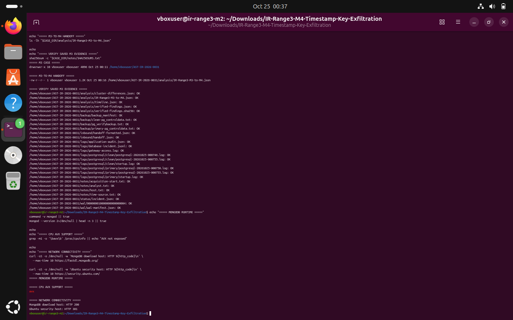
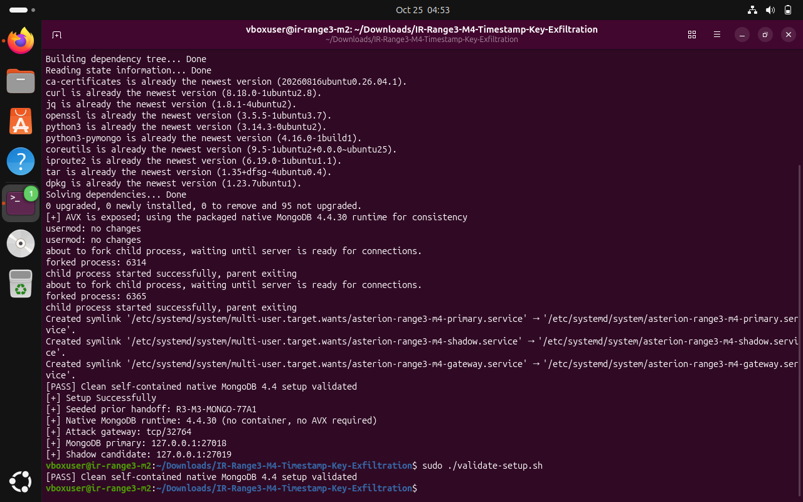
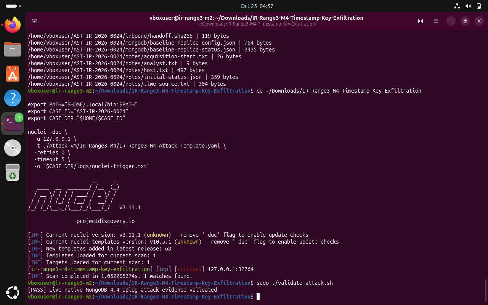
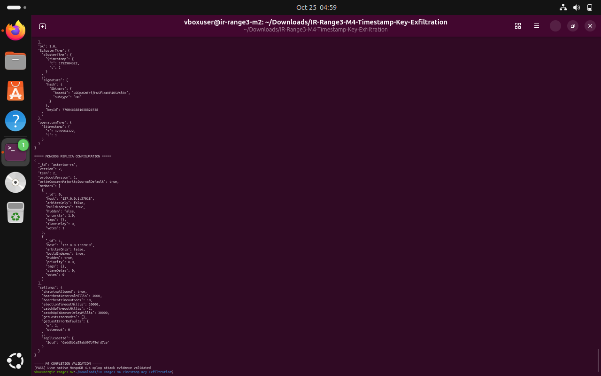
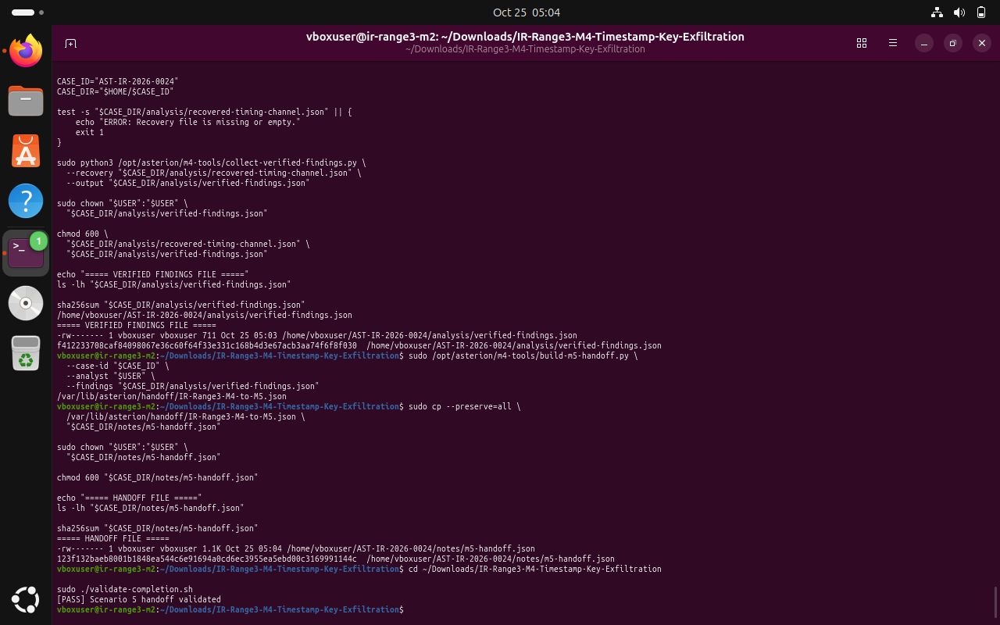

# IR-Range3-M4 — Timestamp-Key Exfiltration

> **Case ID:** `AST-IR-2026-0024`  
> **Handoff:** M4 → M5 handoff  
> **Scope:** Local native MongoDB lab gateway on 127.0.0.1:32764. Oplog timing evidence was decoded using the supplied tool; raw archive key is excluded.

**Source note:** This Markdown write-up is derived from the completed Word report for the corresponding controlled Asterion Range 3 lab. The evidence images are the terminal screenshots embedded in that report. Interpret findings within the simulated lab context.

---

## 1. Executive Summary

This report records the M4 lab investigation for the Asterion BioSystems “Timestamp-Key Exfiltration” scenario. The scenario uses native MongoDB replica-set evidence and an oplog timing channel. The supported workflow preserved the incoming M3 handoff, checked the clean baseline, triggered the supplied Nuclei template against localhost, preserved generated evidence, recovered the simulated archive key, created verified findings, generated the M4-to-M5 handoff, and passed the completion validator.

> Final observed result
> The terminal capture shows: “[PASS] Scenario 5 handoff validated.” This is a scenario-completion result; it does not prove that real-world incident containment, credential rotation, replica rebuild, or restoration activities were executed.

### Document Control

| Field | Recorded value |
| --- | --- |
| Report title | IR-Range3-M4: Timestamp-Key Exfiltration |
| Case folder | ~/AST-IR-2026-0024/ |
| Scenario chain | M3 PostgreSQL history → M4 MongoDB oplog timing channel → M5 handoff |
| Observed analyst label | vboxuser (shown by case artifacts and terminal prompt) |
| Evidence handling | Preserved copies and SHA-256 manifests; archive key excluded from this report |
| Primary source material | M4 package Blue-Writeup.md, README.md, scenario.json, QA-REPORT.md; submitted screenshots |

### Outcome at a Glance

| Checkpoint | Observed outcome |
| --- | --- |
| Native MongoDB setup | Passed clean baseline validation |
| Scenario trigger | Nuclei reported one match against 127.0.0.1:32764 |
| Attack validator | Passed: live native MongoDB 4.4 oplog evidence validated |
| Timestamp channel | Recovery output indicated the archive key was recovered; 64 key bits decoded |
| Verified findings | JSON findings file generated and hashed |
| M4 → M5 handoff | Generated and copied into the case notes; SHA-256 recorded |
| Completion validator | Passed: Scenario 5 handoff validated |

## 2. Scope, Context, and Method

The M4 package describes a MongoDB replication and exfiltration scenario that assumes the preceding M3 stage was completed. The included IR-Range3-M3-to-M4 handoff is prerequisite context, not M4 attack telemetry. During the controlled scenario, the valid Nuclei dispatch adds a hidden, non-voting replica member, stages the inherited research-record identifiers, and encodes a runtime-derived 64-bit archive key and a laboratory media number into genuine MongoDB oplog wall-time intervals.

### Investigation objectives

- Preserve the inherited M3 handoff and baseline replica-set state before triggering the scenario.
- Validate the native MongoDB 4.4.30 runtime and clean M4 baseline.
- Trigger only the supplied M4 Nuclei template against the local gateway.
- Preserve incident status, MongoDB primary/shadow logs, oplog timing export, topology, staged records, and network-flow summary.
- Recover the timing channel without exposing the raw archive key in the report or chat.
- Create verified findings and the M4-to-M5 handoff, then run the supplied completion validator.
### Observed environment

| Item | Observed / documented value |
| --- | --- |
| Gateway identity | IR-Range3-M4 reported by /health and /api/v1/status |
| MongoDB replica set | asterion-rs |
| Primary member | 127.0.0.1:27018 |
| Shadow candidate | 127.0.0.1:27019 |
| Replica candidate attributes | hidden: true; priority: 0.0; votes: 0 |
| Attack gateway | TCP 32764 |
| Nuclei version | v3.11.1 |
| M4 case folder | ~/AST-IR-2026-0024/ |

> Simulation boundary
> All reported behavior is from the supplied controlled lab. The successful local trigger and validator are not evidence of real external network exfiltration beyond the simulated environment.

## Evidence E-01 — Preflight: inherited M3 evidence checks and runtime connectivity

This capture shows verification of the saved M3 handoff/evidence manifest and preflight network checks. The MongoDB download host returned HTTP 200; the Ubuntu security host returned HTTP 301 (redirect). The capture does not show a validation of the M4 setup script hash.



*Figure E-01. Preflight: inherited M3 evidence checks and runtime connectivity.*

*Interpretation: the screenshot records the operator-visible output at this stage. Findings in the report are limited to what the shown output and package materials support.*

## 3. Package Integrity and Setup

The M4 package’s native runtime is MongoDB Community Server 4.4.30, installed under /opt/asterion rather than a container runtime. The package documentation specifies an Ubuntu 22.04 x86-64 target and describes isolated OpenSSL 1.1 compatibility libraries for the MongoDB 4.4 binary. The terminal’s package manager output indicated an Ubuntu 26.04-era userland; the setup and live validators nevertheless passed on the observed host.

### Integrity exception: setup.sh checksum

The supplied FILE-MANIFEST.sha256 listed a different digest for setup.sh than the extracted file actually produced. The difference was not resolved by altering the manifest. The script syntax check passed, and setup and scenario validation subsequently passed, but those runtime checks do not remove the original supply-chain integrity discrepancy.

| Source | SHA-256 |
| --- | --- |
| Expected in FILE-MANIFEST.sha256 | 090185ce7720643db57e1d562cdbdf98a572cb9d9cdefdfe958c48ceaa6397e4 |
| Observed extracted setup.sh | 1fa520ed3b1adfeb7043a2463eec1c05d2f6de01b5cec71110e914e320d688f7 |

> Audit note
> Do not edit FILE-MANIFEST.sha256 to make this mismatch disappear. For future repeatability, preserve the original package, the discrepant hash comparison, the syntax-check result, and runtime validator outputs together.

### Setup commands executed

```bash
cd ~/Downloads/IR-Range3-M4-Timestamp-Key-Exfiltration
bash -n setup.sh
sudo ./setup.sh
sudo ./validate-setup.sh
```

Setup output showed the native MongoDB 4.4.30 runtime starting, installed systemd service links for primary, shadow and gateway services, and a clean-baseline validation pass. It reported the seeded handoff R3-M3-MONGO-77A1, gateway TCP 32764, primary port 27018, and shadow candidate port 27019.

## Evidence E-02 — Native MongoDB setup and baseline validation

The setup capture reports the clean self-contained MongoDB 4.4 baseline validated, the three M4 services installed/enabled, and the primary/shadow ports listed. The subsequent direct validate-setup.sh command also returned a pass.



*Figure E-02. Setup created the native replica-set services; clean setup validation passed.*

> Result
> Clean MongoDB setup validated. Primary: 127.0.0.1:27018. Shadow candidate: 127.0.0.1:27019. Gateway: TCP 32764.

## Evidence E-03 — Controlled scenario trigger and attack validation

The operator ran the supplied M4 Nuclei template against 127.0.0.1. Nuclei v3.11.1 reported one matching result against the local gateway, followed by a successful validator for native MongoDB oplog attack evidence.



*Figure E-03. One template match and successful live oplog evidence validation.*

> Observed validator output
> [PASS] Live native MongoDB 4.4 oplog attack evidence validated.

## Evidence E-04 — Replica topology after the controlled incident

The live replica configuration displayed two members. The expected primary was at 127.0.0.1:27018. The second member at 127.0.0.1:27019 was hidden and had priority 0.0 and votes 0, consistent with the package’s unauthorized hidden-member scenario. The attack validator remained passed in this capture.



*Figure E-04. Live replica-set configuration and passing attack-validation result.*

**Replica-set context recorded in the capture:**

| Member | Endpoint | Relevant flags |
| --- | --- | --- |
| Authorized primary member | 127.0.0.1:27018 | hidden: false; priority: 1.0; votes: 1 |
| Shadow / unauthorized member | 127.0.0.1:27019 | hidden: true; priority: 0.0; votes: 0 |

## 4. Evidence Preservation and Integrity

Evidence was copied into the M4 case folder AST-IR-2026-0024 before the recovered findings and handoff were finalized. The operator recorded acquisition start, analyst, host, and time-source notes; preserved the inbound handoff and its SHA-256; captured initial incident status; exported replica config/status; and copied post-incident MongoDB/gateway logs and the generated M4 evidence set.

### Preserved evidence groups

| Directory / artifact | Purpose |
| --- | --- |
| inbound/handoff.json and handoff.sha256 | Preserved inbound M3-to-M4 context and hash |
| mongodb/baseline-replica-config.json | Pre-incident replica topology |
| mongodb/baseline-replica-status.json | Baseline replica status |
| logs/post-incident/ | MongoDB incident/application traces, gateway access and primary/shadow mongod logs where present |
| evidence/post-incident/oplog-timing-export.json | Exported local.oplog.rs timing evidence used by recovery |
| evidence/post-incident/replica-topology.json | Replica topology evidence generated by the incident |
| evidence/post-incident/staged-records.json | Staged-record evidence |
| evidence/post-incident/network-flow-summary.txt | Scenario network-flow summary |
| analysis/recovered-timing-channel.json | Recovered timing-channel data; mode 0600 |
| analysis/verified-findings.json | Findings assembled for the M5 handoff |
| notes/m5-handoff.json | Protected local copy of the M4-to-M5 handoff; mode 0600 |

### Hash checks

- The four files in evidence/post-incident/ passed the SHA-256 manifest check shown in the recovery/preservation terminal capture.
- The recovered timing-channel JSON was individually hashed; its raw contents were kept restricted.
- The verified findings JSON and final handoff copy were each hashed, with the handoff restricted to mode 0600.
- The final case-level manifest verifies the files present in the case folder. A hash only establishes file consistency against the manifest created; it does not independently prove the evidence’s origin.
## 5. Timestamp-Channel Recovery

The package describes an oplog timing-steganography method in which a runtime-derived 64-bit archive key and a laboratory media number are encoded through genuine MongoDB local.oplog.rs wall-time intervals. The recovery utility consumes the preserved oplog timing export, classifies gaps using a threshold, and produces a recovered-timing-channel JSON. The operator then set the recovered output file to mode 0600 and recorded its SHA-256.

### Observed recovery summary

| Field | Recorded result |
| --- | --- |
| Recovery artifact label | AST_MONGO_OPLOG_TIMING_V1 |
| Archive key recovered | True |
| Decoded key length | 64 bits |
| Decision threshold in the scenario config | 450 ms |
| Scenario-configured delay classes | zero: 200 ms; one: 700 ms |
| Recovery file | analysis/recovered-timing-channel.json |
| Recovery file permissions | 0600 |
| Recovery hash record | analysis/recovered-timing-channel.sha256 |

> Credential handling
> The raw archive decryption key is intentionally excluded from this report. The recovered JSON and hash record remain in the case folder with restrictive permissions. Do not paste the raw key into reports, chats, or general-purpose logs.

### Interpretation limits

- Recovery output confirms the lab decoder returned a key and a 64-bit payload.
- The package documentation describes 80 genuine oplog wall-time intervals carrying the preamble, key bits, and media number; this is package behavior, while the decoder’s visible summary specifically reported 64 decoded key bits.
- The screenshots do not reproduce the full raw timing series or raw key. The correct preserved source is the local oplog timing export and its evidence hash.
- No independent external network capture was collected outside the lab’s supplied network-flow artifact.
## 6. Findings and Correlation

### Replica-set configuration

The live config output showed replica set asterion-rs with primary endpoint 127.0.0.1:27018 and a second endpoint 127.0.0.1:27019. The second member’s hidden/non-voting attributes are inconsistent with the baseline described by the package, where the candidate exists but remains unjoined. This is the principal topology indicator in the M4 exercise.

### Inherited scope from the M3 handoff

| Indicator | Value from the inherited context |
| --- | --- |
| Handoff ID | R3-M3-MONGO-77A1 |
| MongoDB synchronization session | MONGO-AST-77A1-884227 |
| PostgreSQL database session | PGS-AST-017-77A1 |
| Campaign marker | MDRN-7F3A |
| Stolen record IDs | EXP-AX17, EXP-CR42, EXP-NV08 |
| Modified record IDs | EXP-AX17, EXP-CR42 |
| PostgreSQL native XIDs | 742, 743, 744 (as listed in inbound package handoff) |
| Asterion transaction references | 884201, 884219, 884227 |

*Important: these IDs are inherited scope/context from the M3 handoff. Their presence in that JSON is not, by itself, M4 attack telemetry. The M4 validator and the generated M4 evidence set separately confirm that the M4 scenario ran.*

### Verified recovery outputs

- The recovery utility reported AST_MONGO_OPLOG_TIMING_V1 and “Archive key recovered: True.”
- A verified-findings JSON was generated from the recovery output and SHA-256 recorded.
- The M4-to-M5 handoff was generated from the verified findings and copied to the local case folder.
- The completion validator accepted the resulting Scenario 5 handoff.
## Evidence E-05 — Verified findings, handoff creation, and final validator

This capture documents the findings collector, the M4-to-M5 handoff builder, the protected local handoff copy and its hash, followed by the final completion validator. The case folder is AST-IR-2026-0024. The handoff output path reported by the builder is /var/lib/asterion/handoff/IR-Range3-M4-to-M5.json.



*Figure E-05. M4-to-M5 handoff created and validated.*

> Final validator
> [PASS] Scenario 5 handoff validated.

## 7. M4-to-M5 Handoff and Final State

The builder created /var/lib/asterion/handoff/IR-Range3-M4-to-M5.json using case ID AST-IR-2026-0024, the analyst label shown in the current shell, and analysis/verified-findings.json. The handoff was copied to notes/m5-handoff.json and restricted to mode 0600. The screenshot shows the resulting local hash command and successful completion validator.

### Handoff data expected to carry forward

- Verified staged/modified record scope and original/manipulated record-set hashes.
- MongoDB native transaction/session references and oplog manifest hash.
- Recovered key hash and laboratory media reference—without placing the plaintext key in the report.
- Replica-set anomaly context, evidence paths and preservation guidance for M5.
- The handoff’s preservation note advises correlating the MongoDB session identifier and exact queue/timing window with the next scenario’s evidence.
### Final status

| Validation item | Result |
| --- | --- |
| M4 clean setup validation | Passed |
| M4 attack validator | Passed |
| Evidence file SHA-256 manifest | All listed post-incident evidence files shown as OK |
| Recovered timing channel | Key-recovered boolean true; 64 bits decoded |
| Verified findings | File generated and hashed |
| M4-to-M5 handoff | Generated, copied, hashed, permissions restricted |
| Completion validator | [PASS] Scenario 5 handoff validated |

## 8. Deviations, Limitations, and Recordkeeping

### Package integrity discrepancy

The package manifest’s expected setup.sh digest differs from the actual extracted file digest (full values are recorded in Section 3). The manifest was not amended. Runtime setup, attack and completion validations passed, but these do not constitute a resolution of the hash discrepancy. Preserve the original ZIP and manifest if this work is used in an audit or assessment.

### Runtime environment deviations

- The M4 setup ran in an Ubuntu VM whose terminal prompt still displayed ir-range3-m2. The M4 service and gateway reported machine identity IR-Range3-M4 and the M4 validators passed. The retained hostname is a lab hygiene deviation and should be corrected in an isolated clone before the next task if desired.
- The package documentation describes an Ubuntu 22.04 x86-64 KVM target; package-manager output in the live setup screenshot reflected Ubuntu 26.04-era packages. M4 runtime validation did pass in the observed environment, but the host differs from the documented target.
- The incoming M3 handoff was intentionally preserved as prerequisite context; its original case metadata was not rewritten to match the M4 case folder.
- The low-resolution capture of the sanitized timing-recovery summary is not reproduced as a primary readable figure; the documented summary is limited to the visible recovery status, decoded bit count, configured threshold, and protected file/hash outputs.
### Actions not established as completed

The completion validator checks handoff readiness. The submitted terminal sequence does not establish that containment and eradication were performed. The package runbook recommends preserving the primary/shadow oplogs and logs, freezing writes, revoking the over-privileged sync-service credential, removing the unauthorized member under change control, rebuilding replicas from a trusted snapshot, rotating credentials, and monitoring for recurring reconfiguration or irregular write timing. These remain recommended follow-up actions unless separately evidenced.

## 9. Containment and Recovery Recommendations

> Order matters
> Preservation should precede removal of a replica member, deletion of staged records, or credential rotation. The following are recommended operational actions from the package runbook, not actions evidenced as completed in this session.

1. Freeze writes from the MongoDB synchronization application and stop the affected queue from dispatching further work.
1. Revoke the over-privileged application credential and terminate its active sessions, after preserving connection and audit evidence.
1. Preserve the primary and shadow data directories, local.oplog.rs evidence, replica configuration, mongod logs, application trace, gateway logs, and network-flow summary.
1. Remove the hidden non-voting member from the approved replica configuration under change control, after forensic capture has been verified.
1. Rebuild affected replica members from a trusted snapshot and validate the authorized topology and application replication profile.
1. Rotate database/application credentials, review least-privilege roles, and validate the sync queue and staging collections before restoring service.
1. Retain immutable copies and hashes of manipulated records and recovered timing evidence for post-incident review.
1. Monitor replica reconfiguration, unusual initial-sync activity, abnormal oplog write spacing, and unexpected removable-media references.
### Closure criteria for the investigation

- Verified findings file and handoff hash retained.
- Raw recovered key isolated with restrictive permissions; plaintext not copied to the report.
- Replica topology restored to an approved configuration and independently verified.
- Credentials rotated and relevant application access reviewed.
- Staging scope correlated to the inherited M3 record set and documented for M5.
- Any operational containment/recovery steps supported by separate records, timestamps, and hashes.
## 10. Learning Points and Conclusion

### Five key learnings

**Replica configuration is evidence. **A hidden, non-voting member can exist in the real replica-set config even when an application trace reports routine success. Capture config and status before containment.

**Oplog timing can carry data. **MongoDB oplog wall-time intervals can encode information through timing differences; analysis needs the original exported intervals and their hash, not only an application success banner.

**Preserve inherited scope, but distinguish it from new telemetry. **The M3 handoff tells responders which sessions and records to examine, while the M4 live logs, topology, staged-records artifact and validator provide the M4 execution evidence.

**A passing validator is not the same as remediation. **The final validator confirms the Scenario 5 handoff. It does not demonstrate that credentials were rotated, the unauthorized member removed, or services safely restored.

**Integrity warnings should remain visible. **The setup.sh manifest mismatch must be documented rather than hidden. File hash checks and runtime validation provide different kinds of assurance and should not be conflated.

### Conclusion

The controlled M4 scenario was triggered locally, validated against native MongoDB oplog evidence, and used to recover a 64-bit simulated archive key from the timing channel. The post-incident evidence files were hashed and verified, a verified-findings file was generated, and the M4-to-M5 handoff was created and accepted by the scenario completion validator. The unresolved setup.sh package-manifest mismatch and the lack of evidence for containment/eradication are retained as explicit caveats.

> Recorded outcome
> Task 4 is documented as completed to the scenario’s handoff-validation requirement. Containment and recovery tasks remain unverified unless evidenced separately.

## Appendix A — Main Commands Recorded

The following compact command sequence reflects the key steps shown in the submitted terminal captures. Variables are defined explicitly for repeatability. No plaintext archive key is included.

### A1. Preflight and setup

```bash
cd ~/Downloads/IR-Range3-M4-Timestamp-Key-Exfiltration
bash -n setup.sh
sha256sum setup.sh
# Compare against the setup.sh line in FILE-MANIFEST.sha256
sudo ./setup.sh
sudo ./validate-setup.sh
```

### A2. Controlled trigger and validation

```bash
export PATH="$HOME/.local/bin:$PATH"
CASE_ID="AST-IR-2026-0024"
CASE_DIR="$HOME/$CASE_ID"
mkdir -p "$CASE_DIR/logs"

nuclei -duc \
  -u 127.0.0.1 \
  -t ./Attack-VM/IR-Range3-M4/IR-Range3-M4-Attack-Template.yaml \
  -retries 0 -timeout 5 \
  -o "$CASE_DIR/logs/nuclei-trigger.txt"

sudo ./validate-attack.sh
```

### A3. Protected case paths

```bash
# Post-incident evidence was preserved under:
$CASE_DIR/evidence/post-incident/
$CASE_DIR/logs/post-incident/
$CASE_DIR/mongodb/post-incident/
$CASE_DIR/analysis/
$CASE_DIR/notes/

# Recovered timing-channel file retained with restrictive permissions:
chmod 600 "$CASE_DIR/analysis/recovered-timing-channel.json"
sha256sum "$CASE_DIR/analysis/recovered-timing-channel.json" \
  > "$CASE_DIR/analysis/recovered-timing-channel.sha256"
```

## Appendix A — Main Commands Recorded (continued)

### A4. Verified findings and handoff

```bash
sudo python3 /opt/asterion/m4-tools/collect-verified-findings.py \
  --recovery "$CASE_DIR/analysis/recovered-timing-channel.json" \
  --output "$CASE_DIR/analysis/verified-findings.json"

sudo /opt/asterion/m4-tools/build-m5-handoff.py \
  --case-id "$CASE_ID" \
  --analyst "$USER" \
  --findings "$CASE_DIR/analysis/verified-findings.json"

sudo cp --preserve=all \
  /var/lib/asterion/handoff/IR-Range3-M4-to-M5.json \
  "$CASE_DIR/notes/m5-handoff.json"
sudo chown "$USER":"$USER" "$CASE_DIR/notes/m5-handoff.json"
chmod 600 "$CASE_DIR/notes/m5-handoff.json"
sha256sum "$CASE_DIR/notes/m5-handoff.json"
```

### A5. Final validation and recordkeeping

```bash
cd ~/Downloads/IR-Range3-M4-Timestamp-Key-Exfiltration
sudo ./validate-completion.sh

# Observed output:
[PASS] Scenario 5 handoff validated
```

### Appendix B — Evidence Screenshot Register

| Evidence ID | Source capture | What it supports |
| --- | --- | --- |
| E-01 | image(20261025-003740).png | Preflight: M3 handoff and saved-evidence checks; download connectivity |
| E-02 | image(20261025-045323).png | Native MongoDB setup and clean baseline validation |
| E-03 | image(20261025-045756).png | Nuclei match and M4 attack validator pass |
| E-04 | image(20261025-045938).png | Live replica-set configuration, hidden shadow member, validator pass |
| E-05 | image(20261025-050445).png | Verified findings, M4-to-M5 handoff generation, local copy hash, final pass |

*Supplementary terminal captures also recorded package script review, preservation/hash output, the sanitized timing-channel recovery summary, and runbook context. The narrow low-resolution recovery capture was not embedded as a primary readable figure; details here are limited to the decoded bit count and protected recovery-file metadata.*
