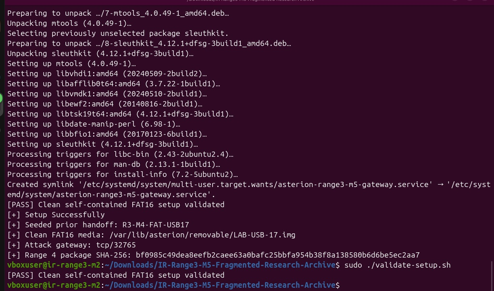
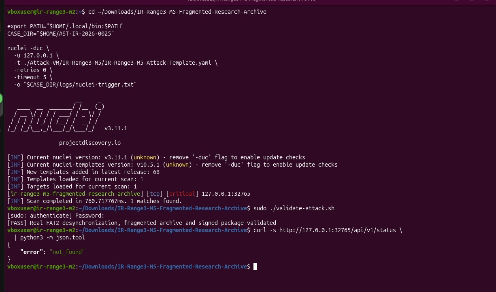
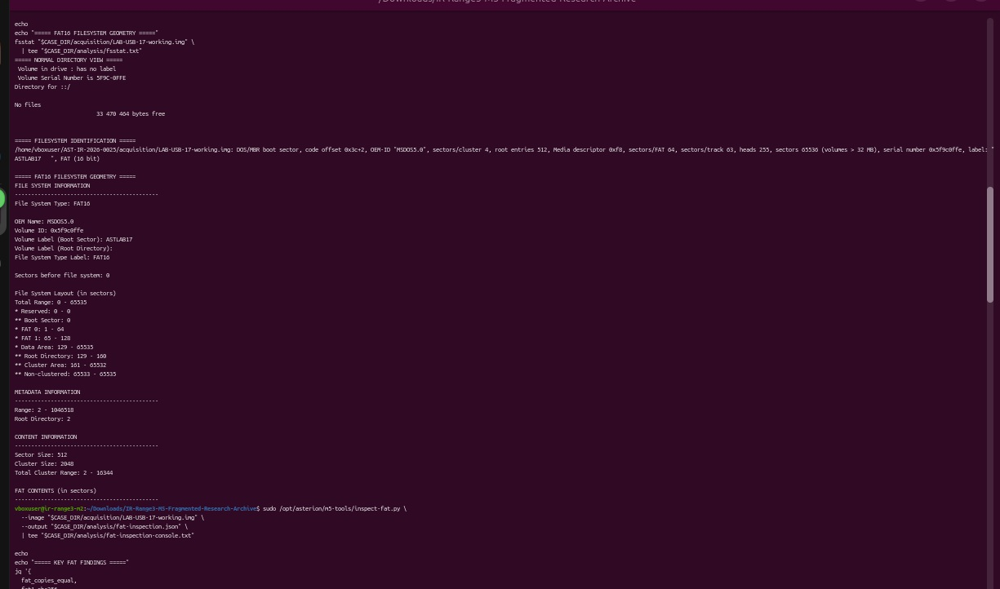
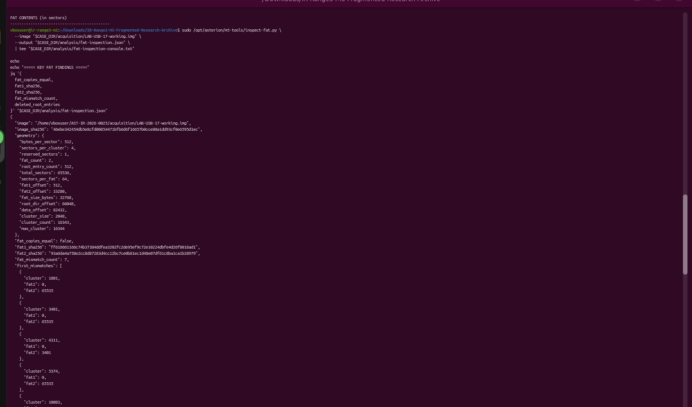
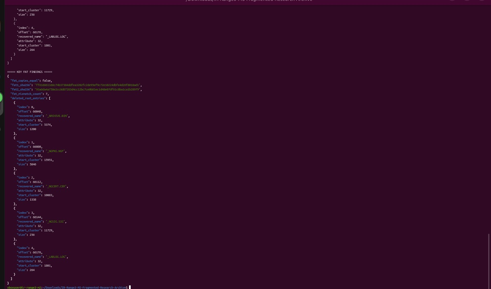
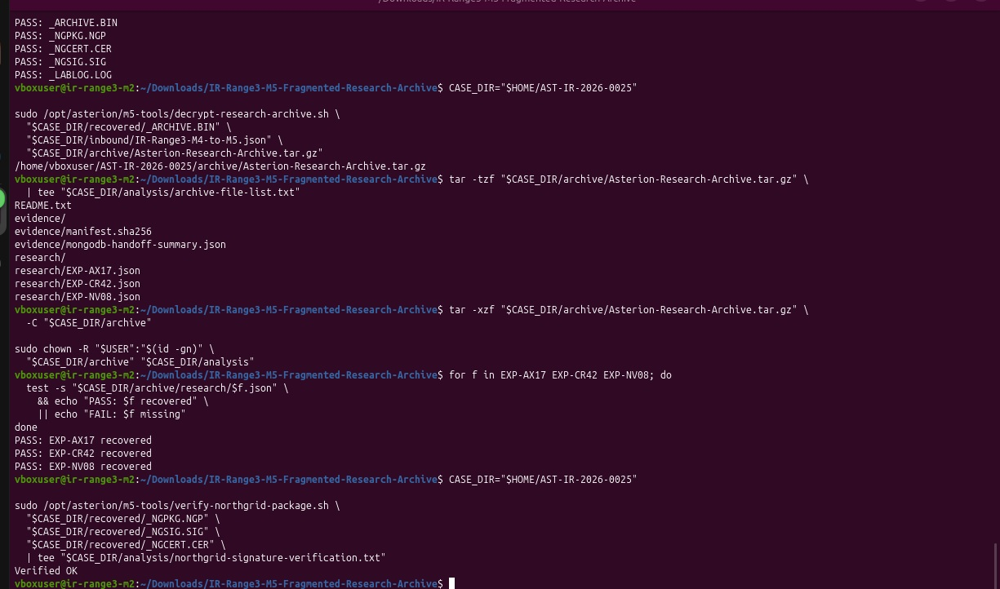
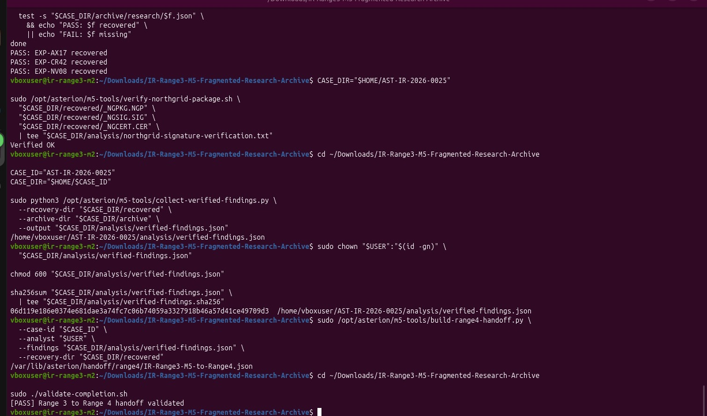

# IR-Range3-M5 — Fragmented Research Archive

> **Case ID:** `AST-IR-2026-0025`  
> **Handoff:** Range 4 handoff  
> **Scope:** Local removable-media lab gateway on 127.0.0.1:32765. FAT16 recovery and detached signature verification are documented; no maintenance package was executed.

**Source note:** This Markdown write-up is derived from the completed Word report for the corresponding controlled Asterion Range 3 lab. The evidence images are the terminal screenshots embedded in that report. Interpret findings within the simulated lab context.

---

## 1. Executive summary

Task 5 investigated removable laboratory media LAB-USB-17 after a controlled scenario created inconsistent FAT16 allocation metadata, deleted root-directory entries, a fragmented encrypted research archive, and a signed NorthGrid maintenance package. The ordinary directory listing showed no files, while forensic inspection exposed divergence between the two FAT copies and five deleted entries.

The five files were recovered using the second FAT copy. The encrypted research archive was decrypted using the inherited M4-to-M5 handoff context and contained three research records: EXP-AX17, EXP-CR42, and EXP-NV08. A detached signature check for the recovered NorthGrid package returned “Verified OK”. The verified-findings collector and Range 4 handoff builder ran, and final completion validation passed.

This is a controlled training scenario. A successful digital signature establishes that the package matches the supplied certificate’s public key; it does not establish that executing the package would be safe. The recovered package and maintenance entrypoint were handled as forensic evidence and were not executed.

### Verified outcome summary

| Control point | Observed result |
| --- | --- |
| Clean FAT16 baseline | Setup and validate-setup.sh passed. |
| Scenario trigger | Nuclei found one match against local gateway 127.0.0.1:32765. |
| Attack validator | Passed: FAT2 desynchronization, fragmented archive, signed package. |
| Filesystem findings | FAT copies differ; 7 mismatches; 5 deleted root-directory entries. |
| Recovered files | Five files recovered through FAT2 chains. |
| Archive contents | Three research JSON records recovered and present. |
| Package signature | Detached signature verification printed Verified OK. |
| Range 4 handoff | Final validator printed [PASS] Range 3 to Range 4 handoff validated. |

### Scope and handling notes

- Work was performed inside the Asterion Range 3 lab. Network testing was scoped to the local gateway on 127.0.0.1:32765.
- The original media image should remain unchanged; analysis is performed on the working and preserved copies.
- The M4-derived archive key and raw recovery metadata are sensitive. This report does not display the key or embed the raw key-bearing JSON.
- The VM terminal prompt continued to display ir-range3-m2 while the M5 service reported IR-Range3-M5. The report records the prompt discrepancy and relies on M5-specific service output and validators for scenario identity.
- The attempted /api/v1/status route returned {"error":"not_found"}. This endpoint was unavailable on the M5 gateway; the dedicated validators passed and were used as completion evidence.
## 2. Scenario overview and evidence timeline

The supplied M5 package describes a removable-media forensics incident. The live worker places the hidden files in non-contiguous FAT data clusters, changes FAT2 while leaving FAT1 free, and marks the root entries deleted. The result is designed to look empty under ordinary directory listing even though the data is recoverable from the alternate allocation table.

| Time shown | Checkpoint | Evidence/result |
| --- | --- | --- |
| 05:25 | Setup and baseline | Clean self-contained FAT16 setup validated. |
| 05:28 | Controlled trigger | Nuclei returned one match; attack validator passed. |
| 05:31 | Filesystem triage | Normal listing empty; FAT16 geometry recorded; FAT copies not equal. |
| 05:31 | FAT entry analysis | 7 mismatches and 5 deleted root entries identified. |
| 05:34 | Recovery and signature | Five files passed recovery checks; archive listed/extracted; signature Verified OK. |
| 05:36 | Verified findings/handoff | Findings collected; Range 4 handoff built; completion validator passed. |

### Lab environment

| Item | Observed/configured value |
| --- | --- |
| Case workspace | ~/AST-IR-2026-0025/ |
| M5 media | /var/lib/asterion/removable/LAB-USB-17.img |
| Attack gateway | TCP 32765; local target 127.0.0.1 |
| Filesystem | FAT16, two FAT copies |
| Inherited handoff | IR-Range3-M4-to-M5.json; handoff ID R3-M4-FAT-USB17 |
| Vendor identity | NG-VENDOR-42 |
| Maintenance package | NG04_Maintenance_2026-06.ngpkg |
| Target substation | NG-04 |
| Campaign marker | MDRN-7F3A |

## 3. Setup and clean baseline

The setup script installed the forensic utilities required for FAT analysis, created the self-contained FAT16 media, seeded the M4 handoff, and started the M5 gateway. The clean-baseline validator returned the explicit pass message shown in Evidence E01.

### Commands used

```bash
cd ~/Downloads/IR-Range3-M5-Fragmented-Research-Archive
chmod +x setup.sh reset.sh validate-setup.sh validate-attack.sh validate-completion.sh
sha256sum -c FILE-MANIFEST.sha256
bash -n setup.sh
bash Attack-VM/IR-Range3-M5/verify-attack-assets.sh
sudo ./setup.sh
sudo ./validate-setup.sh
```



*E01 — Clean FAT16 baseline setup and validation*

Observed output: [PASS] Clean self-contained FAT16 setup validated; image path /var/lib/asterion/removable/LAB-USB-17.img; gateway port 32765.

The setup output also reported that the M4 handoff was seeded as R3-M4-FAT-USB17 and printed the expected NorthGrid maintenance-package SHA-256. The terminal host prompt remained ir-range3-m2; this is noted as a host label rather than used as the scenario identity.

## 4. Controlled scenario trigger and validation

The supplied Nuclei template was run against the local M5 gateway. The screenshot records one match and the M5 attack validator pass. The validator checks that the media image changed from the clean baseline, that FAT1 and FAT2 differ, that five deleted root entries exist, that five recoverable files are present, that the encrypted archive and research records are valid, and that the NorthGrid package signature verifies.

```bash
cd ~/Downloads/IR-Range3-M5-Fragmented-Research-Archive
export PATH="$HOME/.local/bin:$PATH"
CASE_DIR="$HOME/AST-IR-2026-0025"
mkdir -p "$CASE_DIR/logs"

nuclei -duc \
  -u 127.0.0.1 \
  -t ./Attack-VM/IR-Range3-M5/IR-Range3-M5-Attack-Template.yaml \
  -retries 0 -timeout 5 \
  -o "$CASE_DIR/logs/nuclei-trigger.txt"

sudo ./validate-attack.sh
```



*E02 — Scenario trigger and validator result*

Observed output: one matching result for 127.0.0.1:32765, followed by [PASS] Real FAT2 desynchronization, fragmented archive and signed package validated.

### Endpoint note

A request to /api/v1/status returned not_found. This route was not implemented by the M5 gateway, so no incident conclusions were drawn from that request. The dedicated attack validator passed.

## 5. Image acquisition and normal filesystem view

After the trigger, the documented workflow uses two copies: a working image acquired from the live media path and the incident-time image preserved by the attack worker. Their hashes should match. The image was identified as FAT16. The ordinary mdir view reported “No Files”, which is a key observation but not proof that the media contained no data.

```bash
CASE_DIR="$HOME/AST-IR-2026-0025"
mkdir -p "$CASE_DIR"/{acquisition,analysis}

sudo dd if=/var/lib/asterion/removable/LAB-USB-17.img \
  of="$CASE_DIR/acquisition/LAB-USB-17-working.img" \
  bs=4M status=progress conv=noerror,sync

sudo cp --preserve=all \
  /var/lib/asterion/m5-evidence/LAB-USB-17-after.img \
  "$CASE_DIR/acquisition/LAB-USB-17-preserved.img"

sudo chown -R "$USER":"$(id -gn)" "$CASE_DIR"
sha256sum "$CASE_DIR/acquisition/"*.img \
  | tee "$CASE_DIR/acquisition/image-hashes.sha256"

mdir -i "$CASE_DIR/acquisition/LAB-USB-17-working.img" :: \
  | tee "$CASE_DIR/analysis/normal-directory-view.txt"
file "$CASE_DIR/acquisition/LAB-USB-17-working.img" \
  | tee "$CASE_DIR/analysis/file-identification.txt"
fsstat "$CASE_DIR/acquisition/LAB-USB-17-working.img" \
  | tee "$CASE_DIR/analysis/fsstat.txt"
```



*E05 — Empty directory view and FAT16 identification*

The normal directory listing showed No Files; filesystem identification reported FAT16. An empty top-level view was treated as a lead for forensic analysis, not a conclusion that the media was empty.

## 6. FAT16 geometry and desynchronization

The filesystem inspection described a FAT16 volume with two FAT copies. The displayed geometry included 512 bytes per sector, 4 sectors per cluster (2,048-byte clusters), 512 root-directory entries, and 65,535 total sectors. The inspection output reported fat_copies_equal: false and fat_mismatch_count: 7.

| Finding | Observed result | Interpretation |
| --- | --- | --- |
| Filesystem type | FAT16 | Supported by file and fsstat outputs. |
| FAT copy comparison | fat_copies_equal: false | Redundant allocation tables disagree. |
| Mismatch count | 7 | More than five discrepancies; validator expects divergence. |
| Deleted root entries | 5 | Metadata for five files remains recoverable. |
| FAT1 allocation | Clusters reported free for hidden items | Normal listing follows FAT1’s apparently empty chains. |
| FAT2 allocation | Allocated chains remain present | Recovery uses FAT2’s surviving allocation metadata. |



*E04 — FAT16 geometry and mismatch evidence*

The inspection output included geometry and hashes for FAT1 and FAT2, plus differing cluster entries.

## 7. Deleted root-directory entry analysis

The FAT inspection recovered five deleted root entries. Their first filename character is shown as an underscore because the original entry was marked deleted. The surviving entry fields included the starting cluster and byte size, allowing the supplied recovery tool to follow allocation chains from FAT2.

| Recovered name | Start cluster shown | Reported size (bytes) |
| --- | --- | --- |
| _ARCHIVE.BIN | 5374 | 1209 |
| _NGPKG.NGP | 15951 | 5845 |
| _NGCERT.CER | 10883 | 1338 |
| _NGSIG.SIG | 11729 | 256 |
| _LABLOG.LOG | 1801 | 254 |



*E03 — FAT inspection output and five deleted root entries*

The key findings block in the console showed five entries and the recorded fat_mismatch_count of 7.

### Interpretation

The discrepancy is structural: FAT1 and FAT2 provide inconsistent allocation descriptions. The normal filesystem path can appear empty if it follows FAT1, while FAT2 retains allocated chains to the payload data. This lab demonstrates why investigators should compare redundant filesystem metadata and not rely exclusively on normal directory enumeration.

## 8. FAT2 file recovery and research archive reconstruction

The supplied recovery tool reconstructed all five files from the incident-time image using FAT2 chains. The terminal output showed PASS for each recovered artifact. The encrypted archive was then decrypted using the preserved M4-to-M5 handoff context and listed before extraction.

```bash
sudo /opt/asterion/m5-tools/recover-fat2-files.py \
  --image "$CASE_DIR/acquisition/LAB-USB-17-working.img" \
  --output-dir "$CASE_DIR/recovered" \
  | tee "$CASE_DIR/analysis/fat2-recovery.json"

sudo chown -R "$USER":"$(id -gn)" "$CASE_DIR/recovered"
sha256sum "$CASE_DIR/recovered"/* \
  | tee "$CASE_DIR/analysis/recovered-files.sha256"

sudo /opt/asterion/m5-tools/decrypt-research-archive.sh \
  "$CASE_DIR/recovered/_ARCHIVE.BIN" \
  "$CASE_DIR/inbound/IR-Range3-M4-to-M5.json" \
  "$CASE_DIR/archive/Asterion-Research-Archive.tar.gz"

tar -tzf "$CASE_DIR/archive/Asterion-Research-Archive.tar.gz" \
  | tee "$CASE_DIR/analysis/archive-file-list.txt"
tar -xzf "$CASE_DIR/archive/Asterion-Research-Archive.tar.gz" \
  -C "$CASE_DIR/archive"
```



*E06 — Recovered files, archive listing, and signature verification*

Terminal evidence confirms all five file recoveries passed, research records were present, and the NorthGrid detached signature verifier returned Verified OK.

### Recovered archive contents

| Path inside archive | Role |
| --- | --- |
| evidence/manifest.sha256 | Archive evidence manifest. |
| evidence/mongodb-handoff-summary.json | Record-set and session context inherited from M4. |
| research/EXP-AX17.json | Research record 1. |
| research/EXP-CR42.json | Research record 2. |
| research/EXP-NV08.json | Research record 3. |

The archived manifest should be checked before using any recovered record downstream. Record-level correlation is important here because the files are evidence carried across two scenarios, not independent proof of the original incident by themselves.

The collector does more than test whether an archive can be opened: it requires the exact three-record set expected by the scenario and checks that each corresponding research JSON file exists. These checks make the record set reproducible and suitable for controlled downstream handoff.

Interpretation: a matching record set shows continuity between the inherited M4 incident context and the recovered M5 archive. It does not, by itself, prove who handled the media or whether the vendor package was authorized for a specific maintenance window.

The recovery process used the M4 handoff context. The archive record set aligns with the three identifiers expected by the M5 findings collector: EXP-AX17, EXP-CR42, and EXP-NV08.

### Record-set validation logic

The packaged collector checks that the archive summary contains EXP-AX17, EXP-CR42 and EXP-NV08, and that research/<record-id>.json exists for each identifier. It also validates the recovered NorthGrid package against its detached signature and live runtime metadata before emitting verified findings.

Sensitive material: the archive key is used only through the supplied decryption utility and is not reproduced in this report. Keep any raw key-bearing result file permission-restricted.

## 9. NorthGrid package and signature verification

The recovered package asset set consisted of _NGPKG.NGP, _NGSIG.SIG, and _NGCERT.CER. The supplied verification helper reported Verified OK. The verified-findings collector independently verifies the package/signature/certificate combination and compares several fields against live M5 runtime findings before emitting its JSON output.

| Field | Validated value |
| --- | --- |
| Package name | NG04_Maintenance_2026-06.ngpkg |
| Expected package SHA-256 | bf0985c49dea8eefb2caee63a0bafc25bbfa954b38f8a138580b6d6be5ec2aa7 |
| Detached signature | NG04_Maintenance_2026-06.ngpkg.sig |
| Vendor certificate identity | NG-VENDOR-42 |
| Certificate SHA-256 fingerprint | b7d1c65f9a46b255f4c5dfc2e43d54124164900b99f5360a92e58fd695ba7799 |
| Target substation | NG-04 |
| Campaign marker | MDRN-7F3A |

```bash
sudo /opt/asterion/m5-tools/verify-northgrid-package.sh \
  "$CASE_DIR/recovered/_NGPKG.NGP" \
  "$CASE_DIR/recovered/_NGSIG.SIG" \
  "$CASE_DIR/recovered/_NGCERT.CER" \
  | tee "$CASE_DIR/analysis/northgrid-signature-verification.txt"
```

### Trust interpretation

The successful signature check shows that the recovered package matches the detached signature under the public key in the supplied certificate. This alone does not show that the package was authorized for this specific maintenance window, that the certificate was handled appropriately, or that the payload is harmless. The recovered package was treated as untrusted content and was not executed.

### Additional static inspection

```bash
sha256sum \
  "$CASE_DIR/recovered/_NGPKG.NGP" \
  "$CASE_DIR/recovered/_NGSIG.SIG" \
  "$CASE_DIR/recovered/_NGCERT.CER" \
  | tee "$CASE_DIR/analysis/northgrid-asset-hashes.sha256"

openssl x509 -in "$CASE_DIR/recovered/_NGCERT.CER" \
  -noout -subject -issuer -serial -dates -fingerprint -sha256 \
  | tee "$CASE_DIR/analysis/northgrid-certificate.txt"

unzip -l "$CASE_DIR/recovered/_NGPKG.NGP" \
  | tee "$CASE_DIR/analysis/northgrid-package-list.txt"
```

## 10. Verified findings and incident interpretation

The collector validates recovered media files, archive record IDs, package/certificate/signature consistency, and live runtime references. It writes analysis/verified-findings.json and a SHA-256 record. The later handoff builder checks the maintenance-package SHA-256, certificate fingerprint, target substation, vendor identity, and campaign marker before producing the Range 4 handoff.

| Finding | Value / status |
| --- | --- |
| Laboratory media | LAB-USB-17 |
| FAT mismatch count | 7 |
| Deleted root-directory entry count | 5 |
| Research record set | EXP-AX17, EXP-CR42, EXP-NV08 |
| M4 archive key reference | AST-R3-M4-ARCHIVE-771C (reference only; key omitted) |
| Vendor certificate | NG-VENDOR-42 |
| Target | NG-04 |
| Campaign marker | MDRN-7F3A |
| Verified findings | Generated and SHA-256 recorded. |

### Causal assessment

The direct forensic indicators are consistent with intentional filesystem metadata manipulation: a normal FAT16 listing is empty, FAT1 and FAT2 differ, FAT1 leaves relevant clusters free while FAT2 retains allocation chains, and the deleted entries provide names, sizes, and starting clusters for recovery. The archive and package recover successfully, and package signature verification succeeds. Attribution beyond the scenario-provided campaign marker and handoff metadata was not independently established in this work.

## 11. Range 4 handoff and completion

The M5 handoff builder created the Range 4 package transfer and chain-of-custody record. The completion validator checks that the JSON handoff, chain-of-custody markdown, package, detached signature, and certificate are present; it checks key metadata, package hash, signature validation, and the runtime range4_handoff_ready flag.

| Handoff field | Value |
| --- | --- |
| Handoff ID | R3-M5-NG-04 |
| Source | IR-Range3-M5 |
| Destination | IR-Range4-M1 — Maintenance Script Compromise |
| Case ID | AST-IR-2026-0025 |
| Package | NG04_Maintenance_2026-06.ngpkg |
| Package SHA-256 | bf0985c49dea8eefb2caee63a0bafc25bbfa954b38f8a138580b6d6be5ec2aa7 |
| Certificate | NG-VENDOR-42 |
| Target | NG-04 |
| Campaign marker | MDRN-7F3A |
| System handoff path | /var/lib/asterion/handoff/range4/IR-Range3-M5-to-Range4.json |
| Final validator | [PASS] Range 3 to Range 4 handoff validated |

```bash
sudo /opt/asterion/m5-tools/collect-verified-findings.py \
  --recovery-dir "$CASE_DIR/recovered" \
  --archive-dir "$CASE_DIR/archive" \
  --output "$CASE_DIR/analysis/verified-findings.json"

sudo /opt/asterion/m5-tools/build-range4-handoff.py \
  --case-id "$CASE_ID" \
  --analyst "$USER" \
  --findings "$CASE_DIR/analysis/verified-findings.json" \
  --recovery-dir "$CASE_DIR/recovered"

sudo ./validate-completion.sh
```



*E07 — Verified findings, generated handoff, and completion pass*

The screenshot shows the findings output hash, the generated system handoff path, and the final passing completion validator.

### Handoff scope

The handoff transfers verified forensic copies, relevant hashes, vendor certificate context, package/signature files, and a chain-of-custody description. The original LAB-USB-17 media remains an Asterion evidence item. No maintenance payload was executed.

## 13. Learning points

**1. Do not trust a single filesystem view. **A normal directory listing can be empty while surviving metadata and cluster data still allow reconstruction.

**2. Compare redundant metadata. **FAT1/FAT2 divergence provided the key lead; corroborating multiple structures is stronger than assuming either table is authoritative.

**3. Preserve before recovery. **Keep separate baseline, incident-time, working, recovered, and analysis artifacts. Hash files as they are acquired and derived.

**4. Cryptographic validity is not operational approval. **A valid detached signature supports integrity/authenticity under a certificate, but authorization, provenance, and package behavior must be assessed separately.

**5. Handoff quality is part of incident response. **The final handoff links a verified package hash, certificate identity, target, campaign marker, case ID, and chain-of-custody record for the next response team.

### Limitations and cautions

- The environment is a simulated incident-response challenge; findings apply to the supplied lab state.
- The raw archive key is not included in this report. Only its inherited reference is named.
- The API status URL tested was not implemented and returned not_found; task-specific validation was used instead.
- The console hostname continued to display ir-range3-m2; M5-specific validator and service output establishes the scenario context.
- The system-level Range 4 handoff was confirmed by the completion validator. A post-validation copy of the handoff/chain-of-custody files into the user-level case folder is recommended if it has not already been done.
- The report captures the acquisition/recovery procedure; if the case-wide SHA256SUMS.txt manifest has not yet been created, run the finalization commands in Appendix D to add it.
## Appendix A — Setup and controlled trigger

```bash
cd ~/Downloads/IR-Range3-M5-Fragmented-Research-Archive
sha256sum -c FILE-MANIFEST.sha256
bash -n setup.sh
bash Attack-VM/IR-Range3-M5/verify-attack-assets.sh
sudo ./setup.sh
sudo ./validate-setup.sh

export PATH="$HOME/.local/bin:$PATH"
CASE_ID="AST-IR-2026-0025"
CASE_DIR="$HOME/$CASE_ID"
mkdir -p "$CASE_DIR"/{inbound,acquisition,analysis,recovered,archive,notes,handoff,logs}

nuclei -duc \
  -u 127.0.0.1 \
  -t ./Attack-VM/IR-Range3-M5/IR-Range3-M5-Attack-Template.yaml \
  -retries 0 -timeout 5 \
  -o "$CASE_DIR/logs/nuclei-trigger.txt"

sudo ./validate-attack.sh
```

## Appendix B — Acquisition and FAT inspection

```bash
sudo cp /etc/asterion/IR-Range3-M4-to-M5.json "$CASE_DIR/inbound/"
sudo chown "$USER":"$USER" "$CASE_DIR/inbound/IR-Range3-M4-to-M5.json"
python3 -m json.tool "$CASE_DIR/inbound/IR-Range3-M4-to-M5.json"
sha256sum "$CASE_DIR/inbound/IR-Range3-M4-to-M5.json" \
  | tee "$CASE_DIR/inbound/IR-Range3-M4-to-M5.sha256"

sudo dd if=/var/lib/asterion/removable/LAB-USB-17.img \
  of="$CASE_DIR/acquisition/LAB-USB-17-working.img" \
  bs=4M status=progress conv=noerror,sync
sudo cp /var/lib/asterion/m5-evidence/LAB-USB-17-after.img \
  "$CASE_DIR/acquisition/LAB-USB-17-preserved.img"
sudo chown -R "$USER":"$USER" "$CASE_DIR"
sha256sum "$CASE_DIR/acquisition/"*.img \
  | tee "$CASE_DIR/acquisition/image-hashes.sha256"

mdir -i "$CASE_DIR/acquisition/LAB-USB-17-working.img" ::
file "$CASE_DIR/acquisition/LAB-USB-17-working.img"
fsstat "$CASE_DIR/acquisition/LAB-USB-17-working.img"

sudo /opt/asterion/m5-tools/inspect-fat.py \
  --image "$CASE_DIR/acquisition/LAB-USB-17-working.img" \
  --output "$CASE_DIR/analysis/fat-inspection.json" \
  | tee "$CASE_DIR/analysis/fat-inspection-console.txt"

jq '{fat_copies_equal,fat1_sha256,fat2_sha256,fat_mismatch_count,deleted_root_entries}' \
  "$CASE_DIR/analysis/fat-inspection.json"
```

## Appendix C — Recovery, archive, signature, handoff

```bash
sudo /opt/asterion/m5-tools/recover-fat2-files.py \
  --image "$CASE_DIR/acquisition/LAB-USB-17-working.img" \
  --output-dir "$CASE_DIR/recovered" \
  | tee "$CASE_DIR/analysis/fat2-recovery.json"
sudo chown -R "$USER":"$USER" "$CASE_DIR/recovered"
sha256sum "$CASE_DIR/recovered"/* \
  | tee "$CASE_DIR/analysis/recovered-files.sha256"

sudo /opt/asterion/m5-tools/decrypt-research-archive.sh \
  "$CASE_DIR/recovered/_ARCHIVE.BIN" \
  "$CASE_DIR/inbound/IR-Range3-M4-to-M5.json" \
  "$CASE_DIR/archive/Asterion-Research-Archive.tar.gz"
tar -tzf "$CASE_DIR/archive/Asterion-Research-Archive.tar.gz" \
  | tee "$CASE_DIR/analysis/archive-file-list.txt"
tar -xzf "$CASE_DIR/archive/Asterion-Research-Archive.tar.gz" -C "$CASE_DIR/archive"

sudo /opt/asterion/m5-tools/verify-northgrid-package.sh \
  "$CASE_DIR/recovered/_NGPKG.NGP" \
  "$CASE_DIR/recovered/_NGSIG.SIG" \
  "$CASE_DIR/recovered/_NGCERT.CER"

sudo /opt/asterion/m5-tools/collect-verified-findings.py \
  --recovery-dir "$CASE_DIR/recovered" \
  --archive-dir "$CASE_DIR/archive" \
  --output "$CASE_DIR/analysis/verified-findings.json"

sudo /opt/asterion/m5-tools/build-range4-handoff.py \
  --case-id "$CASE_ID" --analyst "$USER" \
  --findings "$CASE_DIR/analysis/verified-findings.json" \
  --recovery-dir "$CASE_DIR/recovered"
sudo ./validate-completion.sh
```

## Appendix D — Optional final case-folder closure

The final system handoff was validated. If you want a local case-folder copy of the system handoff and chain-of-custody record, and a combined SHA-256 manifest for the complete case folder, run the following on the lab VM. These commands do not expose the archive key.

```bash
CASE_DIR="$HOME/AST-IR-2026-0025"
mkdir -p "$CASE_DIR/handoff"

sudo cp --preserve=all \
  /var/lib/asterion/handoff/range4/IR-Range3-M5-to-Range4.json \
  "$CASE_DIR/handoff/"
sudo cp --preserve=all \
  /var/lib/asterion/handoff/range4/CHAIN-OF-CUSTODY.md \
  "$CASE_DIR/handoff/"
sudo chown -R "$USER":"$(id -gn)" "$CASE_DIR/handoff"

find "$CASE_DIR" -type f \
  ! -path "$CASE_DIR/notes/SHA256SUMS.txt" \
  -print0 | sort -z | xargs -0 sha256sum \
  > "$CASE_DIR/notes/SHA256SUMS.txt"

sha256sum -c "$CASE_DIR/notes/SHA256SUMS.txt"
```

## Appendix E — Key artifact paths

| Artifact | Path |
| --- | --- |
| Case folder | ~/AST-IR-2026-0025/ |
| Working image | acquisition/LAB-USB-17-working.img |
| Incident-preserved image | acquisition/LAB-USB-17-preserved.img |
| FAT analysis | analysis/fat-inspection.json |
| Recovered files | recovered/ |
| Decrypted archive | archive/Asterion-Research-Archive.tar.gz |
| Verified findings | analysis/verified-findings.json |
| System handoff | /var/lib/asterion/handoff/range4/IR-Range3-M5-to-Range4.json |
| Chain of custody | /var/lib/asterion/handoff/range4/CHAIN-OF-CUSTODY.md |
